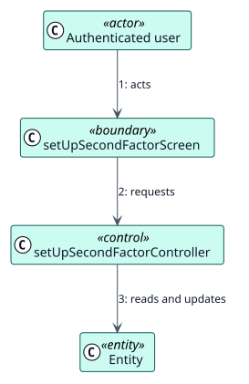

# UC-008 Set up a second factor — analysis realization

| Overview | Requirements | Analysis | Design | Implementation | Tests |
| --- | --- | --- | --- | --- | --- |
| [Use cases](../../../01-requirements/use-case-overview.svg) | [Requirements](../../../01-requirements/use-cases/setUpSecondFactor/README.md) | **Analysis** | [Design](../../../03-design/use-cases/setUpSecondFactor/README.md) | [Implementation](../../../04-implementation/use-cases/setUpSecondFactor/README.md) | [Tests](../../../04-implementation/use-cases/setUpSecondFactor/README.md#tests) |

Requirements: [README](../../../01-requirements/use-cases/setUpSecondFactor/README.md)

## Participating classes

| Class | Stereotype | Responsibility |
| --- | --- | --- |
| Security page, `/me/second-factors` | boundary | Register and remove factors |
| Second-factor service | control | Apply RN-029, RN-032 |
| Second factor, Passkey, Recovery code | entity | Persisted state |

## Collaboration

## Notes

A passkey can be first and second factor at once; it then counts as strong authentication.
