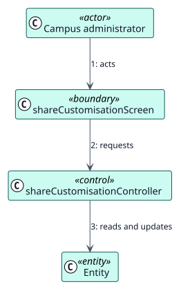

# UC-058 Export and import customisations — analysis realization

| Overview | Requirements | Analysis | Design | Implementation | Tests |
| --- | --- | --- | --- | --- | --- |
| [Use cases](../../../01-requirements/use-case-overview.svg) | [Requirements](../../../01-requirements/use-cases/shareCustomisation/README.md) | **Analysis** | [Design](../../../03-design/use-cases/shareCustomisation/README.md) | [Implementation](../../../04-implementation/use-cases/shareCustomisation/README.md) | [Tests](../../../04-implementation/use-cases/shareCustomisation/README.md#tests) |

Requirements: [README](../../../01-requirements/use-cases/shareCustomisation/README.md)

## Participating classes

| Class | Stereotype | Responsibility |
| --- | --- | --- |
| Packages page, `POST /scopes/{id}/customisation-imports` | boundary | Collect the request |
| Package service | control | Apply RN-221 to RN-222 |
| Customisation package | entity | Persisted state |

## Collaboration

## Notes

Every change is one transaction with its events in the outbox (DEC-016).
