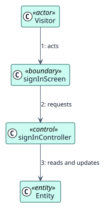

# UC-007 Sign in, or recover access — analysis realization

| Overview | Requirements | Analysis | Design | Implementation | Tests |
| --- | --- | --- | --- | --- | --- |
| [Use cases](../../../01-requirements/use-case-overview.svg) | [Requirements](../../../01-requirements/use-cases/signIn/README.md) | **Analysis** | [Design](../../../03-design/use-cases/signIn/README.md) | [Implementation](../../../04-implementation/use-cases/signIn/README.md) | [Tests](../../../04-implementation/use-cases/signIn/README.md#tests) |

Requirements: [README](../../../01-requirements/use-cases/signIn/README.md)

## Participating classes

| Class | Stereotype | Responsibility |
| --- | --- | --- |
| Sign-in page, `/auth/*` | boundary | Collect credentials |
| Sign-in pipeline | control | Apply RN-024, RN-027 to RN-031 |
| Account, Credential, Session, Sign-in attempt | entity | Persisted state |

## Collaboration

## Notes

Each method is a step implementation inside the same pipeline; a new method cannot be added without the other steps.
