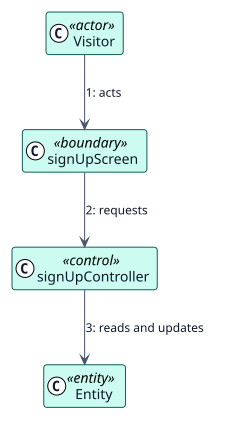

# UC-006 Sign up and confirm an account — analysis realization

| Overview | Requirements | Analysis | Design | Implementation | Tests |
| --- | --- | --- | --- | --- | --- |
| [Use cases](../../../01-requirements/use-case-overview.svg) | [Requirements](../../../01-requirements/use-cases/signUp/README.md) | **Analysis** | [Design](../../../03-design/use-cases/signUp/README.md) | [Implementation](../../../04-implementation/use-cases/signUp/README.md) | [Tests](../../../04-implementation/use-cases/signUp/README.md#tests) |

Requirements: [README](../../../01-requirements/use-cases/signUp/README.md)

## Participating classes

| Class | Stereotype | Responsibility |
| --- | --- | --- |
| Sign-up and confirm pages, `/auth/sign-up`, `/auth/confirm` | boundary | Collect data and the token |
| Account service | control | Apply RN-022 to RN-027 |
| Account, One-time token, Password | entity | Persisted state |

## Collaboration

## Notes

The visible answer never depends on whether the email exists.
