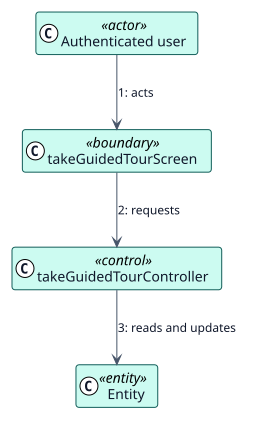

# UC-060 Take a guided tour or follow the onboarding checklist — analysis realization

| Overview | Requirements | Analysis | Design | Implementation | Tests |
| --- | --- | --- | --- | --- | --- |
| [Use cases](../../../01-requirements/use-case-overview.svg) | [Requirements](../../../01-requirements/use-cases/takeGuidedTour/README.md) | **Analysis** | [Design](../../../03-design/use-cases/takeGuidedTour/README.md) | [Implementation](../../../04-implementation/use-cases/takeGuidedTour/README.md) | [Tests](../../../04-implementation/use-cases/takeGuidedTour/README.md#tests) |

Requirements: [README](../../../01-requirements/use-cases/takeGuidedTour/README.md)

## Participating classes

| Class | Stereotype | Responsibility |
| --- | --- | --- |
| Tour runner and checklist of the shell | boundary | Collect the request |
| Onboarding service | control | Apply HB-05 to HB-07 |
| Onboarding checklist, Guided tour, Preference | entity | Persisted state |

## Collaboration

## Notes

Help content is static per release; progress changes are one transaction with their events (DEC-016).
