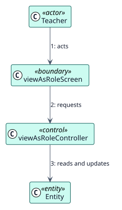

# UC-005 View a scope as another role — analysis realization

| Overview | Requirements | Analysis | Design | Implementation | Tests |
| --- | --- | --- | --- | --- | --- |
| [Use cases](../../../01-requirements/use-case-overview.svg) | [Requirements](../../../01-requirements/use-cases/viewAsRole/README.md) | **Analysis** | [Design](../../../03-design/use-cases/viewAsRole/README.md) | [Implementation](../../../04-implementation/use-cases/viewAsRole/README.md) | [Tests](../../../04-implementation/use-cases/viewAsRole/README.md#tests) |

Requirements: [README](../../../01-requirements/use-cases/viewAsRole/README.md)

## Participating classes

| Class | Stereotype | Responsibility |
| --- | --- | --- |
| View as control, `/scopes/{id}/view-as` | boundary | Start and end |
| View-as service | control | Apply RN-018 |
| View-as session | entity | Persisted state |

## Collaboration

## Notes

Read-only by design: the person sees, never acts, so no audit entry can be blamed on the viewed role.
