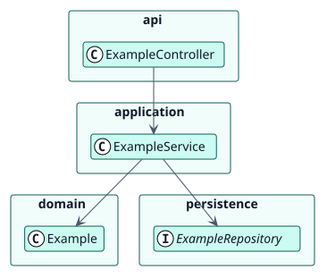
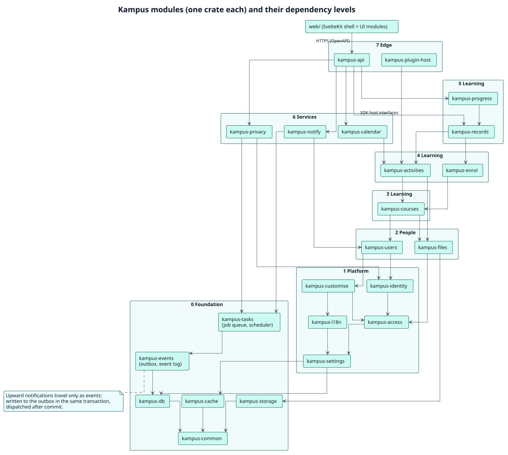
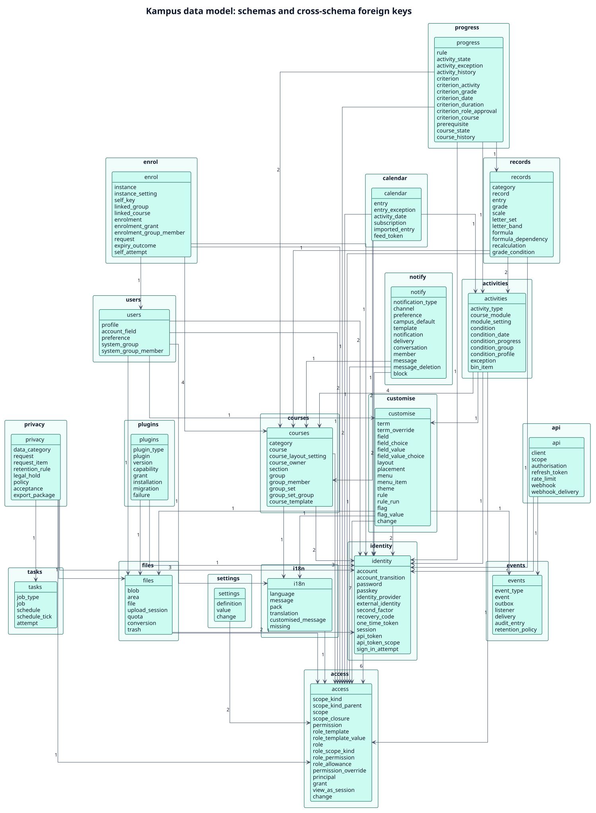
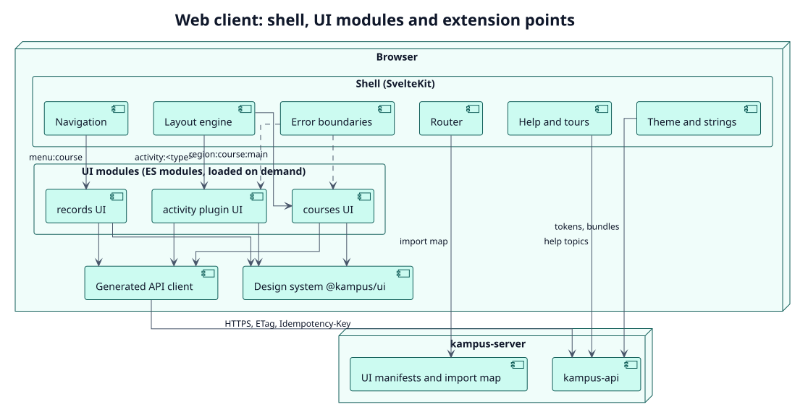
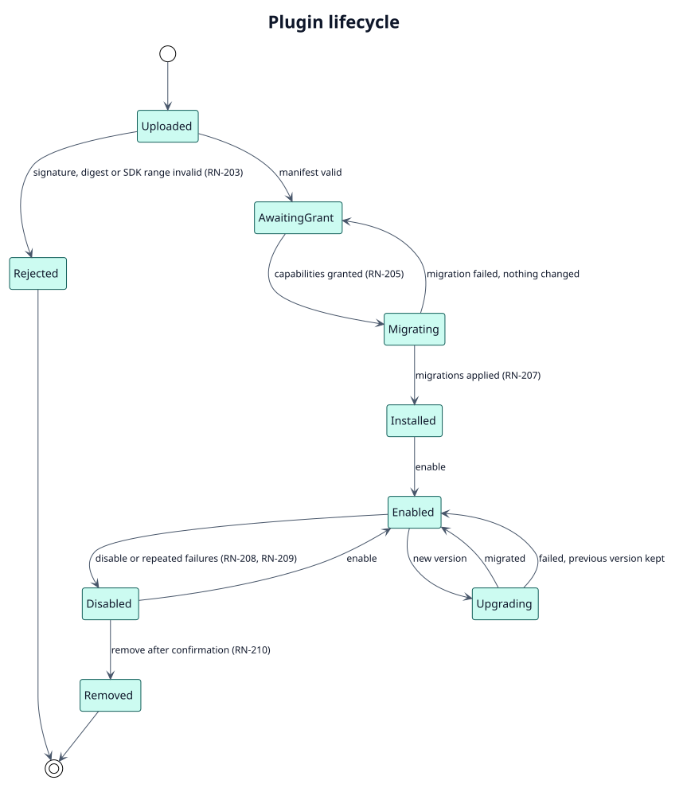
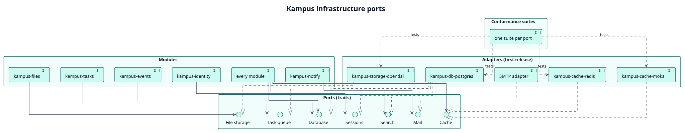
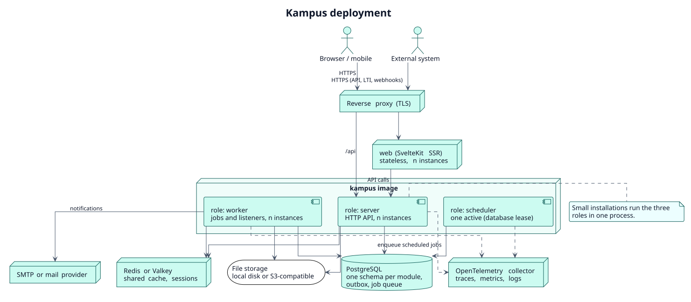

# Design

## Architecture

A modular monolith of one crate per module, in dependency levels, with service APIs, domain events and declared contributions; one image with three roles. See [architecture.md](./architecture.md) (DEC-015 to DEC-020) and the shared conventions in [foundations.md](./foundations.md) (DEC-021 to DEC-026).

## Design classes

## Components

The modules and their dependency levels: a module calls only lower levels, and learns about higher ones through events. The full table and the rules are in [architecture.md](./architecture.md#modules).

## Data model

Names in the data models are **logical** (`module.table`); the installation prefix, `kmp_` by default, goes on the module schema (DEC-039): `courses.group` is `kmp_courses.group` on PostgreSQL and `kmp_courses_group` on dialects without schemas. The rules every data model follows, the linter and the common anti-patterns ruled out are in the [data model conventions](./data-model/conventions.md) (DEC-014, DEC-079, DEC-080); the overview above shows each schema and how many foreign keys link it to the modules before it.

Per module: [access](./data-model/access.md), [identity and users](./data-model/identity.md), [courses](./data-model/courses.md), [enrolment](./data-model/enrolment.md), [activities](./data-model/activities.md), [records](./data-model/records.md), [progress](./data-model/progress.md), [files](./data-model/files.md), [events](./data-model/events.md), [notifications](./data-model/notify.md), [calendar](./data-model/calendar.md), [settings](./data-model/settings.md), [tasks](./data-model/tasks.md), [privacy](./data-model/privacy.md), [languages](./data-model/i18n.md), [integrations](./data-model/integrations.md), [customisation](./data-model/customise.md), [plugins](./data-model/plugins.md).

## API

OpenAPI fragments per module, following DEC-025 and DEC-026: [access](./api/access.openapi.yaml), [identity and users](./api/identity.openapi.yaml), [courses](./api/courses.openapi.yaml), [enrolment](./api/enrolment.openapi.yaml), [activities](./api/activities.openapi.yaml), [records](./api/records.openapi.yaml), [progress](./api/progress.openapi.yaml), [files](./api/files.openapi.yaml), [events](./api/events.openapi.yaml), [notifications](./api/notify.openapi.yaml), [calendar](./api/calendar.openapi.yaml), [settings](./api/settings.openapi.yaml), [tasks](./api/tasks.openapi.yaml), [privacy](./api/privacy.openapi.yaml), [languages](./api/i18n.openapi.yaml), [integrations](./api/integrations.openapi.yaml), [customisation](./api/customise.openapi.yaml), [plugins](./api/plugins.openapi.yaml).

## Web client

Shell, UI module contract, extension points, design system, data and quality: [web client](./web/README.md) (DEC-004, DEC-074 to DEC-076). The documentation for every role and the help inside the product: [handbook](./handbook/README.md) (DEC-011, DEC-077, DEC-078).

## Plugin SDK

Plugin types and their worlds, host interfaces, manifest and lifecycle: [plugin SDK](./sdk/README.md), with the WIT packages in [kampus.wit](./sdk/kampus.wit) (DEC-003, DEC-067 to DEC-069).

## Module layout

The descriptor every module exposes and the folders every module crate follows: [module layout](./module-layout.md) (DEC-015, DEC-087).

## Infrastructure ports

The contract of each port, its adapters and its configuration: [infrastructure ports](./ports/README.md) (DEC-009, DEC-065, DEC-066).

## Deployment

## Use-case realizations

| ID | Use case | Sequence |
| --- | --- | --- |
| | | |

## Project configuration

See [project-configuration.md](./project-configuration.md).
