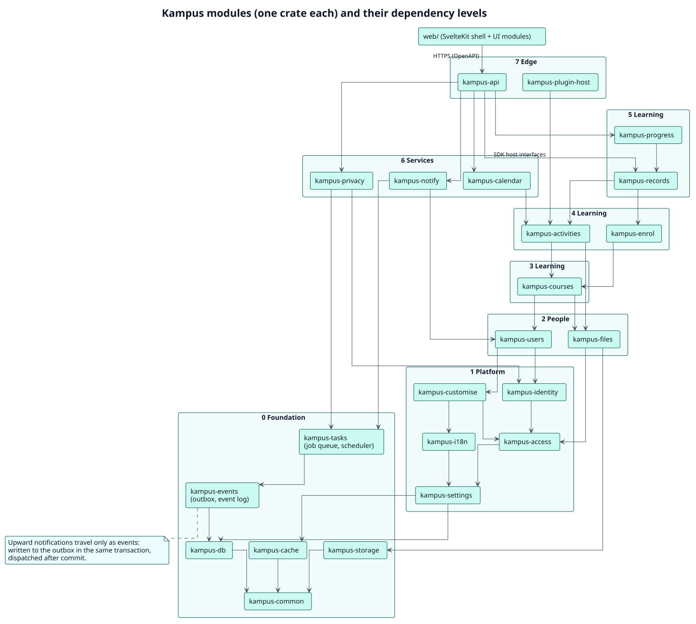
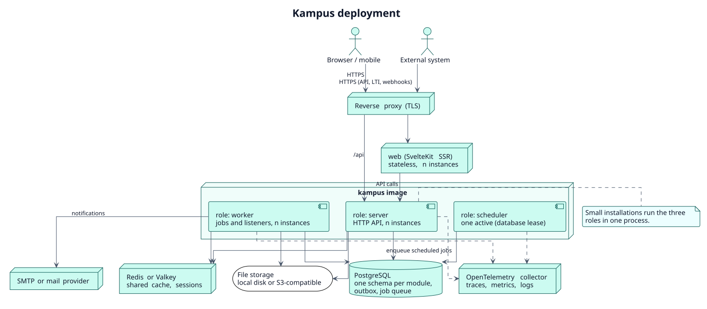

# Architecture

The architecture of Kampus: its modules, how they depend on each other, how they are deployed, and the rules that every module follows for errors, authentication, configuration, events, jobs and observability. It refines DEC-001 (stack), DEC-002 (modular monolith), DEC-003 (plugins), DEC-004 (web client) and DEC-009 (pluggable infrastructure), and records its own choices as DEC-015 to DEC-020.

## Style

A **modular monolith** (DEC-002): one Cargo workspace, one crate per module, composed by one server binary. Each module:

- owns its tables, in its own PostgreSQL schema (DEC-014), and no other module writes them;
- exposes a **service API** (Rust traits and types in its crate) and publishes **domain events**;
- declares what it contributes to the platform through one `Module` descriptor: permissions, settings, events, jobs, privacy data, API routes, UI modules and help topics (DEC-015), in the folders of the [module layout](./module-layout.md) (DEC-087).

Modules call **down** the ranking through service APIs, and learn about things **above** them only through events. Cargo forbids cycles, so the graph stays acyclic by construction.

## Modules

| Level | Crate | Responsibility | Depends on |
| --- | --- | --- | --- |
| 0 Foundation | `kampus-macros` | Macros that read the files of the crate using them, such as the icon of a component | — |
| 0 Foundation | `kampus-common` | Errors, identifiers, time, money, pagination, request context | macros |
| 0 Foundation | `kampus-db` | Database port: neutral schema, dialect adapters (PostgreSQL first), migrations, transactions | common |
| 0 Foundation | `kampus-module` | The module contract (DEC-015, DEC-087): the descriptor every module exposes and the vocabulary of its declarations | common, db |
| 0 Foundation | `kampus-storage` | File storage port: local and S3-compatible first (DEC-009) | common |
| 0 Foundation | `kampus-cache` | Cache port: in-process in front of Redis or Valkey, invalidation by event | common |
| 0 Foundation | `kampus-events` | Event bus with a transactional outbox, event log, listeners (DEC-016) | common, db |
| 0 Foundation | `kampus-tasks` | Durable job queue and scheduler on the database (DEC-016) | common, db, events |
| 1 Platform | `kampus-access` | Scopes (with the section scope, DEC-007), principals, roles, permissions, overrides, checks and explanations; configured by its own declarations and tables, not by settings | common, db, cache, events |
| 1 Platform | `kampus-settings` | Typed settings and their resolution by scope | common, db, cache, events, access |
| 1 Platform | `kampus-identity` | Accounts (principals of access), credentials, OIDC, MFA, sessions, API tokens | common, db, cache, events, access, settings |
| 1 Platform | `kampus-i18n` | Messages, language packs, customised messages, language resolution and locale formatting (DEC-062) | common, db, cache, events, access, settings |
| 2 People | `kampus-files` | File areas and permission-checked serving, on the storage port | storage, access, identity, events |
| 2 People | `kampus-customise` | Terminology, custom fields, layouts, rules, templates, feature flags by scope (DEC-008) | common, db, cache, events, access, settings, identity, i18n, files |
| 2 People | `kampus-users` | Profiles (language, custom fields of accounts), preferences, system groups | identity, access, i18n, files, customise |
| 3 Learning | `kampus-courses` | Categories, courses, sections (nested), course layouts, groups and group sets | access, users, files, customise |
| 4 Learning | `kampus-enrol` | Enrolment methods and enrolments | courses, users, access |
| 4 Learning | `kampus-activities` | Activity registry, course modules, availability, exceptions (RF-054) | courses, access, files |
| 5 Learning | `kampus-records` | Academic records: grade records, categories, aggregation | activities, enrol |
| 5 Learning | `kampus-progress` | Activity and course progress | activities, records, enrol |
| 6 Services | `kampus-notify` | Notifications and messaging through channels | users, customise, tasks |
| 6 Services | `kampus-calendar` | Calendar of campus, course, group and user events | courses, activities |
| 6 Services | `kampus-privacy` | Data export, deletion and retention requests; every module contributes its own data handler through `Module`, so privacy never depends on the modules it serves | identity, tasks |
| 7 Edge | `kampus-api` | HTTP API: REST routes, OpenAPI document, tokens and scopes, webhooks, problem details | the service APIs of every module |
| 7 Edge | `kampus-plugin-host` | WebAssembly runtime for installable plugins and the host side of the SDK (DEC-003) | the service APIs it exposes to plugins |
| Binary | `kampus-server` | Configuration, composition of modules, HTTP server, worker and scheduler roles (DEC-020) | all |

The web client (`web/`, DEC-004) is a separate application that talks only to `kampus-api`.

## Dependency rules

1. A module depends only on modules of a **lower level** or of the same level listed before it in the table. Anything else is a build error.
2. A module **never reads or writes another module's tables**. Foreign keys may point to a module lower in the ranking (DEC-014); all other access goes through that module's service API.
3. Upward communication uses **events**. A module that needs to react to a change in a module above it (for example records reacting to an activity being deleted) listens to that module's event; it never calls up.
4. Contributions to the platform (permissions, settings, events, jobs, privacy, routes, UI modules, help) are **declared** by each module and collected at start-up. No central module lists them by hand, and nothing is discovered by naming conventions.
5. Adapters of infrastructure ports are sub-crates of their port (`crates/<port>/adapters/<name>`), registered by `kampus-server` only; modules depend only on the ports (RNF-019, DEC-086). The repository check fails the build otherwise.

## Cross-cutting concerns

### Request context and authorisation

Every operation runs with a **context**: the actor (user, API client or job), the campus and tenant, the locale and time zone, the request id and the trace. The HTTP layer builds it from the session or the token; jobs build it from their payload.

**Permissions are checked inside the service operation**, against the scope of the object the operation touches, never only in the handler or the page (DEC-017). The same rule holds for the web client, the API and plugins, so no route can skip a check that another route enforces. Lists are filtered by permission in the query, not after paging.

Sessions use secure, HTTP-only cookies; API tokens are scoped, expire, and are stored hashed. Every secret the platform generates comes from a cryptographically secure generator and is stored hashed or encrypted.

### Errors

One error model in `kampus-common` (DEC-018): `not_found`, `unauthenticated`, `permission_denied`, `validation` (with the field and rule), `conflict`, `precondition_failed`, `rate_limited`, `unavailable` and `internal`. Services return these, never strings. The API maps them to HTTP statuses with RFC 9457 problem details, and messages are translatable. Internal errors carry the request id, never a stack trace or data to the client.

### Transactions, events and jobs

- A service operation is **one database transaction**. Its domain events are written to the **outbox in the same transaction** and dispatched after commit, so an event is never lost and never seen for a change that was rolled back (DEC-016).
- Listeners run after commit, idempotently, with retries and a dead-letter state that administrators can see and replay. A failing listener never breaks the operation that triggered it, and never fails silently.
- Long or deferred work is a **job** in a durable queue on the database (`FOR UPDATE SKIP LOCKED`), with retries, back-off, a final failed state with its error, and an alert. Scheduled jobs use the same queue.
- Mail and notifications are jobs: they are never sent inside the request that causes them.

### Configuration

Two kinds, never mixed:

- **Deployment configuration** (database, storage, cache, mail, secrets, roles of the process): a file plus `KAMPUS_*` environment variables, validated at start-up for the role being started, which refuses to start when something is missing or wrong.
- **Runtime settings**: typed settings in `kampus-settings`, resolved by scope (DEC-008), changed through the API with history of who changed what. Values fixed by the deployment are shown as fixed and recorded as such.

### Observability

OpenTelemetry for traces and metrics, structured JSON logs with the request id and trace id, health and readiness endpoints, and metrics for jobs (queued, running, failed), outbox lag and cache hit rates (DEC-019). The **audit log** (who did what to which object) is a separate, append-only store written by the event system, never mixed with operational logs.

### Internationalisation and time

Every user-facing string is an ICU message of its module, resolved by `kampus-i18n` and then through the terminology layer (DEC-008, DEC-012, DEC-062). Times are stored as UTC timestamps with time zone and shown in the user's zone; identifiers, money, pagination and API conventions are fixed by the [platform foundations](./foundations.md).

## Deployment

- **One image** of `kampus-server`, started in one of three roles: `server` (HTTP), `worker` (jobs and listeners) and `scheduler` (one active instance, by database lease) (DEC-020). Small installations run all three in one process.
- The **web client** is its own container (SvelteKit server-side rendering), stateless, behind the same reverse proxy.
- **State lives only in the ports**: PostgreSQL, the file storage (local disk or S3-compatible) and the cache (Redis or Valkey). Server and worker processes are stateless and scale horizontally (RNF-005).
- Upgrades run migrations with the expand-and-contract pattern, so a rolling upgrade of minor versions needs no downtime (RNF-006).
- Local development and every test run in Docker Compose; production uses the same image with Compose or a Helm chart (RNF-013).

## Traceability

| Requirement | Where it is met |
| --- | --- |
| RF-001 written from scratch in Rust | [Style](#style), DEC-001; code provenance checks (RNF-015) |
| RF-002 modular | [Modules](#modules) and [dependency rules](#dependency-rules); feature flags switch modules per scope (DEC-073, UC-057) |
| RF-003 complete core | Tier 1 modules of the [module table](#modules), each with its domain model, data model, API and use cases |
| RF-007 designed for Kampus | One domain model per module listing its rules, and one decision per improvement (DEC-001 onwards), with highlights HL-001 onwards |
| RF-008 modular web client | [Web client](./web/README.md): shell, UI modules and extension points (DEC-004, DEC-074 to DEC-076) |
| RNF-001 security | Permission checks inside services (DEC-017), server-side sessions (DEC-031), signed URLs (DEC-053), sandboxed plugins (DEC-068), webhook address checks (DEC-064) |
| RNF-002 privacy | Privacy handlers declared by every module (DEC-061), tombstones (RN-034), retention per data category |
| RNF-003 accessibility | Design system and accessible tokens (DEC-075, RN-217), accessibility scans per page |
| RNF-004 performance | Permission filtering in the query (RN-020), two-level cache with invalidation by event, indexes from queries (DEC-014 rule 8), a load test before the first release |
| RNF-005 scalability | Stateless roles, state in the ports |
| RNF-006 availability | Expand-and-contract migrations (DEC-080), rolling upgrades |
| RNF-007 maintainability | Dependency rules enforced by the build and by the schema check (DEC-079) |
| RNF-008 testability | One test folder per use case in the traceability table; one test per rule |
| RNF-009 observability | [Observability](#observability) |
| RNF-010 internationalisation | ICU messages and CLDR formatting (DEC-062), right-to-left in the client (RN-192) |
| RNF-011 extensibility | Additive host interfaces within a major SDK version (RN-211), API deprecation with sunset dates (RN-202) |
| RNF-012 plugin isolation | `kampus-plugin-host` (DEC-003, DEC-068) |
| RNF-013 portability | Deployment |
| RNF-014 supply chain | Quality gates of the [project configuration](./project-configuration.md); signed plugin packages (DEC-067) |
| RNF-015 code provenance | Licence checks in the quality gates (DEC-010) |
| RNF-016 database portability | Database port and neutral schema (DEC-065), conformance suite (DEC-066) |
| RNF-017 file storage portability | Storage port ([infrastructure ports](./ports/README.md)) |
| RNF-018 cache portability | Cache port ([infrastructure ports](./ports/README.md)) |
| RNF-019 infrastructure ports | Dependency rule 5, [infrastructure ports](./ports/README.md) |
| RNF-020 documentation quality | [Handbook](./handbook/README.md) with help topics and generated references (DEC-077, DEC-078) |
| RNF-021 data integrity | [Data model conventions](./data-model/conventions.md) (DEC-014, DEC-079, DEC-080) |
