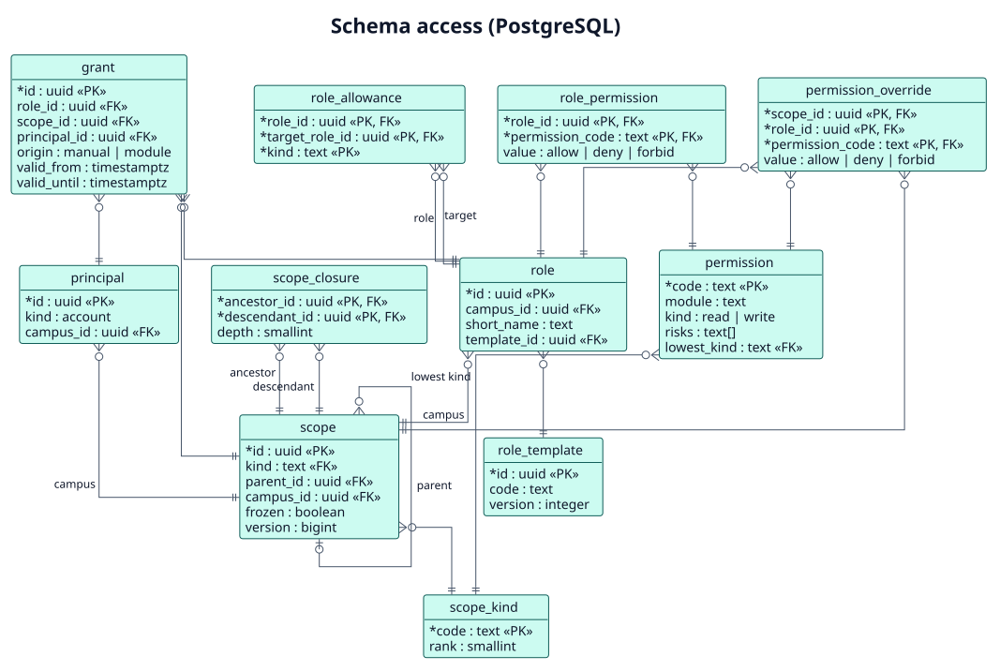

# Data model: access

PostgreSQL schema `access`, owned by `kampus-access` (DEC-014). Keys are UUID version 7 (DEC-021), times `timestamptz` (DEC-022). Every table has `created_at` and `updated_at`; mutable rows carry `version` for optimistic concurrency (DEC-026). Rules refer to the [access domain model](../../00-domain-model/access.md). Table names are logical; physically every name carries the installation prefix, `kmp_` by default (DEC-039).

## Tables

| Table | Columns | Constraints and indexes |
| --- | --- | --- |
| `scope_kind` | `code` text PK, `rank` smallint | Lookup of the nine kinds; `rank` orders them for RN-012 |
| `scope_kind_parent` | `kind` FK, `parent_kind` FK | PK (`kind`, `parent_kind`): which kinds may contain which (RN-001) |
| `scope` | `id`, `kind` FK, `parent_id` FK → `scope` (`ON DELETE CASCADE`), `campus_id` FK → `scope`, `frozen` boolean, `version` | `CHECK` root has no parent; a trigger checks `scope_kind_parent`; index on `parent_id` |
| `scope_closure` | `ancestor_id` FK → `scope`, `descendant_id` FK → `scope`, `depth` smallint | PK (`ancestor_id`, `descendant_id`); index (`descendant_id`, `depth`); kept in the same transaction as every insert or move of a scope |
| `permission` | `code` text PK, `module` text, `kind` (`read`, `write`), `risks` text[] checked against a fixed set, `lowest_kind` FK → `scope_kind`, `retired_at` | Rows synchronised from module declarations at start-up (DEC-015); never deleted while referenced, only retired |
| `role_template` | `id`, `code`, `version` integer, `name_message` | `UNIQUE` (`code`, `version`) |
| `role_template_value` | `template_id` FK (`CASCADE`), `permission_code` FK, `value` | PK (`template_id`, `permission_code`); `value` in (`allow`, `deny`, `forbid`) |
| `role` | `id`, `campus_id` FK → `scope`, `short_name`, `template_id` FK → `role_template`, `version` | `UNIQUE` (`campus_id`, lower(`short_name`)) |
| `role_scope_kind` | `role_id` FK (`CASCADE`), `kind` FK | PK (`role_id`, `kind`): where the role can be granted |
| `role_permission` | `role_id` FK (`CASCADE`), `permission_code` FK, `value` | PK (`role_id`, `permission_code`) |
| `role_allowance` | `role_id` FK (`CASCADE`), `target_role_id` FK (`CASCADE`), `kind` | PK (`role_id`, `target_role_id`, `kind`); `kind` in (`grant`, `override`, `view_as`, `view`) — one table instead of one per kind |
| `permission_override` | `scope_id` FK (`CASCADE`), `role_id` FK (`CASCADE`), `permission_code` FK, `value`, `version` | PK (`scope_id`, `role_id`, `permission_code`); a trigger enforces RN-012 |
| `grant` | `id`, `role_id` FK (`RESTRICT`), `scope_id` FK (`CASCADE`), `user_id` FK → `identity.account`, `origin` (`manual`, `module`), `origin_module` text, `valid_from`, `valid_until`, `granted_by` FK → `identity.account` | `CHECK` `valid_until` > `valid_from`; `CHECK` `origin_module` set if and only if origin is `module`; partial `UNIQUE` (`role_id`, `scope_id`, `user_id`) where origin is `manual`; index (`user_id`, `scope_id`) |
| `view_as_session` | `id`, `user_id` FK, `scope_id` FK (`CASCADE`), `role_id` FK (`CASCADE`), `started_at`, `ended_at` | `CHECK` `ended_at` > `started_at` |
| `change` | `id`, `actor_id`, `entity` text, `entity_id`, `before` jsonb, `after` jsonb, `at` | Append-only history of grants, overrides and roles (RN-015); feeds the audit log (DEC-019) |

Entities of other modules point to their scope: `courses.course.scope_id` FK → `access.scope` `UNIQUE`, and so on for categories, sections, activities, widgets and users. Modules that own grants keep their own link table (for example `enrol.enrolment_grant (enrolment_id, grant_id)`), so `grant` never references a higher module (RN-016, DEC-014 rule 7).

## Queries

- **Active grants on a path** (RN-003): `grant` joined to `scope_closure` on `descendant_id = :scope`, filtered by `user_id` and `now()` between the validity bounds. Served from the cache per user and invalidated by `access.grant_*` events.
- **Value of a role** (RN-004): overrides on the ancestors of the scope ordered by `depth`, first one wins, else `role_permission`.
- **List filtering** (RN-020): an `EXISTS` sub-query on the objects' `scope_id` against the closure of the scopes where the actor's roles allow the permission, so paging happens after filtering.

## Anti-patterns avoided (DEC-014)

| Avoided | How |
| --- | --- |
| Polymorphic scope (`instanceid` by kind) | Entities reference their scope; the scope has no back reference |
| Hierarchy as a path string | Parent key plus closure table, maintained in transactions |
| Duplicate grants removed by code | Partial unique constraint; module grants owned through link tables |
| Permission referenced by a free string | `permission.code` is a primary key with foreign keys to it |
| Risks packed in an integer | A checked set of named risks |
| Administrators as a configuration list that bypasses checks | Administration is a role (RN-007) |
| Four allowance tables of the same shape | One table with a kind |
| Integer times and flags | `timestamptz`, booleans, checked values |
