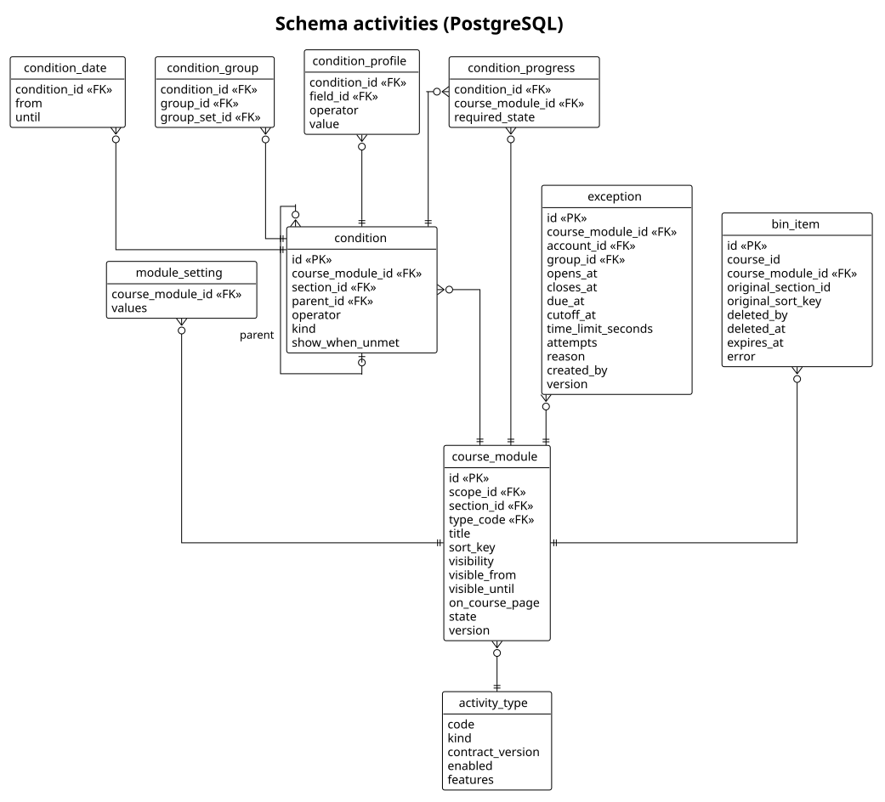

# Data model: activities

PostgreSQL schema `activities`, owned by `kampus-activities`, following DEC-014, DEC-021, DEC-022 and DEC-026. Rules refer to the [activities domain model](../../00-domain-model/activities.md). Names are logical; physically the schema carries the installation prefix, `kmp_activities` by default (DEC-039). Each activity type owns its own schema (`activity_<type>`) for its instance data, with a foreign key to `course_module` and `ON DELETE CASCADE`.

## Tables

| Table | Columns | Constraints and indexes |
| --- | --- | --- |
| `activity_type` | `code` PK, `module`, `kind` (`activity`, `material`), `summary`, `features` jsonb, `settings` jsonb (key, stored kind and default of each), `enabled`, `retired_at` | Synchronised from the declarations of modules (`activity_types`, DEC-015); a type no module provides is retired and its course modules stay |
| `course_module` | `id`, `scope_id` FK → `access.scope` `UNIQUE` (`CASCADE`, an activity scope under the section scope), `section_id` FK → `courses.section` (`CASCADE`), `type_code` FK → `activity_type` (`RESTRICT`), `title`, `sort_key` (`C` collation), `visibility`, `visible_from`, `visible_until`, `on_course_page`, `state` (`active`, `in_bin`), `version`, `created_at` | `UNIQUE` (`section_id`, `sort_key`), counting those in the bin so a new key never meets one; `CHECK` `visible_until` > `visible_from`; index (`section_id`, `state`) |
| `module_setting` | `course_module_id` PK FK (`CASCADE`), `values` jsonb | The settings its type declares, each of its kind; common settings are columns of `course_module`; the defaults fill what is left out (RN-078) |
| `module_file` | `course_module_id` PK FK (`CASCADE`), `file_id` FK → `files.file` (`CASCADE`) `UNIQUE` | The file of a file material, owned through this table (RN-127); a file is read by whoever sees the course module (RN-128); purging the course module detaches it |
| `condition` | `id`, `course_module_id` FK (`CASCADE`, nullable), `section_id` FK → `courses.section` (`CASCADE`, nullable), `parent_id` FK → `condition` (`CASCADE`), `operator` (`all`, `any`, `not`, `leaf`), `kind`, `show_when_unmet` | `CHECK` exactly one of `course_module_id`, `section_id`, `parent_id` set; leaves have one row in their kind's table |
| `condition_date` | `condition_id` PK FK (`CASCADE`), `from`, `until` | `CHECK` at least one set |
| `condition_progress` | `condition_id` PK FK (`CASCADE`), `course_module_id` FK → `course_module` (`RESTRICT`), `required_state` | |
| `condition_group` | `condition_id` PK FK (`CASCADE`), `group_id` FK → `courses.group` (`RESTRICT`, nullable for "any group"), `group_set_id` FK (`RESTRICT`, nullable) | |
| `condition_profile` | `condition_id` PK FK (`CASCADE`), `field_id` FK → `customise.field` (`RESTRICT`), `operator`, `value` | |
| `exception` | `id`, `course_module_id` FK (`CASCADE`), `account_id` FK → `identity.account` (`CASCADE`, nullable), `group_id` FK → `courses.group` (`CASCADE`, nullable), `opens_at`, `closes_at`, `due_at`, `cutoff_at`, `time_limit_seconds`, `attempts`, `reason`, `created_by` (soft), `version` | `CHECK` exactly one of `account_id`, `group_id`; `UNIQUE` (`course_module_id`, `account_id`); `UNIQUE` (`course_module_id`, `group_id`); `CHECK` time limit positive and attempts not negative; the service rejects one that changes nothing. Only types declaring the `exceptions` feature accept them; a person's own wins setting by setting, otherwise the most generous of their groups (earliest to open, latest to close, largest to allow), otherwise the course module (RN-086) |
| `bin_item` | `id`, `course_id` FK → `courses.course` (`CASCADE`), `course_module_id` FK `UNIQUE` (`CASCADE`), `deleted_by` (soft), `deleted_at`, `expires_at` (30 days), `error` | One per course module in the bin; the course module keeps its section and sort key, so restoring puts it back in place; the daily job `activities.purge` removes expired ones with their scope and file, and a failure stays here as `error` (RN-088, RN-089) |
| `course_module_reference` | External references of course modules (step 2), in the shape of the [conventions](conventions.md#external-references) | Read and set with `activities.module.manage` |

Conditions arrive in a later part of activities, once records and progress exist; until then their tables are not created and a course module is shown by its visibility alone. Condition plugins (DEC-003) add their own leaf tables in their schema, with the same pattern; an unknown kind makes the course module unavailable (RN-082).

## Anti-patterns avoided (DEC-014)

| Avoided | How |
| --- | --- |
| Polymorphic `module` + `instance` pair | Each type's instance table references `course_module` |
| Availability as JSON in a text column with ids inside | Typed condition rows with foreign keys |
| Overrides in one table per activity, with different rules | One `exception` table for every activity type |
| Uniqueness of overrides checked in code | Unique constraints and a `CHECK` for person xor group |
| Deletion that leaves hidden orphans when it fails | Bin item with a visible failed state |
