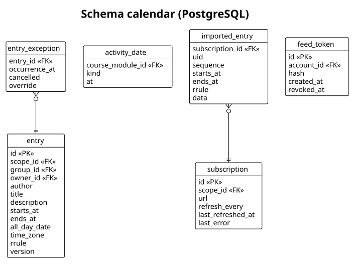

# Data model: calendar

PostgreSQL schema `calendar`, owned by `kampus-calendar`, following DEC-014, DEC-021 and DEC-022. Rules refer to the [calendar domain model](../../00-domain-model/calendar.md). Names are logical; physically the schema carries the installation prefix, `kmp_calendar` by default (DEC-039).

## Tables

| Table | Columns | Constraints and indexes |
| --- | --- | --- |
| `entry` | `id`, `scope_id` FK → `access.scope` (`CASCADE`, nullable), `owner_id` FK → `identity.account` (`CASCADE`, nullable), `author` (soft reference to the account that created it), `title`, `description`, `starts_at`, `ends_at`, `time_zone` (UTC by default), `all_day`, `recurrence` (RFC 5545 rule), `group_id` FK → `courses.group` (`CASCADE`, nullable), `version`, `created_at` | `CHECK` exactly one of `scope_id` and `owner_id`; indexes (`scope_id`, `starts_at`) and (`owner_id`, `starts_at`); a group entry is seen by the members of the group and whoever manages the calendar |
| `entry_exception` | `entry_id` FK (`CASCADE`), `occurrence_at`, `cancelled`, `title`, `starts_at`, `ends_at` | PK (`entry_id`, `occurrence_at`); `CHECK` `ends_at` after `starts_at`; one change per occurrence (step 2) |
| `activity_date` | `course_module_id` FK → `activities.course_module` (`CASCADE`), `kind` (`opens`, `due`, `closes`), `at` | PK (`course_module_id`, `kind`); refreshed by events (RN-157) |
| `subscription` | `id`, `scope_id` FK → `access.scope` (`CASCADE`), `url`, `refresh_every` interval, `last_refreshed_at`, `last_error` | |
| `imported_entry` | `subscription_id` FK (`CASCADE`), `uid`, `sequence`, `starts_at`, `ends_at`, `rrule`, `data` jsonb | PK (`subscription_id`, `uid`) |
| `feed_token` | `id`, `account_id` FK → `identity.account` (`CASCADE`), `hash` `UNIQUE`, `created_at`, `revoked_at` | |

The `entry` table (step 1) exists. The dates of activities are not stored: the calendar of a course reads them from the activities each time and applies the exceptions of the person who asks (RN-157), so there is nothing to refresh. Step 2 adds recurrence, time zones, all-day and group entries, and the exceptions of occurrences: a recurring entry is stored once and expanded when a window is read, in the time zone of the entry so an occurrence keeps its time of day across daylight saving changes (`support/recurrence.rs`: `FREQ` daily, weekly, monthly or yearly with `INTERVAL`, `COUNT` or `UNTIL`, `BYDAY` for weekly and `BYMONTHDAY` for monthly rules, at most 1000 occurrences); changing one occurrence adds an exception, never a copy (RN-158). Subscriptions and feeds arrive in a later part.

## Anti-patterns avoided (DEC-014)

| Avoided | How |
| --- | --- |
| Level of an entry inferred from the first non-zero id | One scope reference |
| One row per occurrence of a repeating event | One rule, expanded when read |
| Imported events removed only when counts differ, without a trace | Diff by UID and sequence, every change recorded |
| Activity dates copied by every module | A projection refreshed by events |
