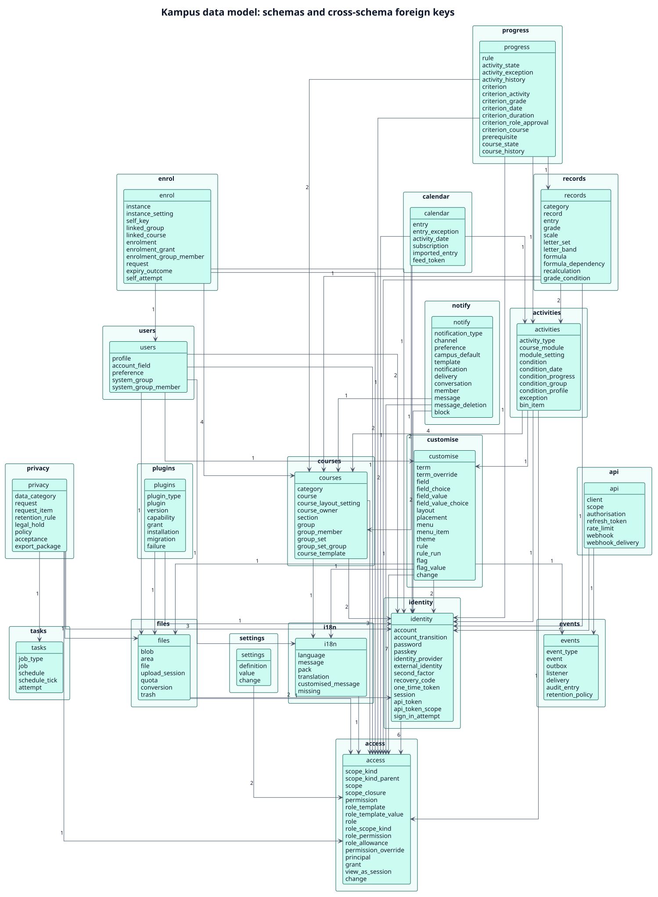

# Data model conventions

The rules every module's data model follows, refining DEC-014 with DEC-079 and DEC-080. A module's data model is checked against them before code; the schema linter of DEC-065 enforces them in CI, and the documentation check enforces rule DM-05 on these documents.

## Schemas and ownership

| ID | Rule |
| --- | --- |
| DM-01 | One schema per module, named after it (`access`, `courses`, `records`…); physically prefixed with the installation prefix (DEC-039). |
| DM-02 | A module writes only its own schema. Other modules read its data through its service API. |
| DM-03 | A table belongs to the module whose rules keep it valid. When a module declares a type that another module's entity uses (a condition type, a custom field, an attachment), the **declaring module owns the leaf or link table**, which references the other entity: grade conditions live in `records`, profile custom fields link from `users`. |
| DM-04 | Concepts referenced by many modules get a supertype in the lowest module that needs them: `access.scope` for everything that has a place in the tree, `access.principal` for everything that holds grants (accounts). The subtype's primary key is a foreign key to the supertype. |
| DM-05 | A foreign key points only to the same module or to a module **earlier** in the module table of the [architecture](../architecture.md#modules) (dependency rule 2). The documentation check fails otherwise. |

## Names

| Element | Convention | Example |
| --- | --- | --- |
| Tables | singular, `snake_case`, without the module name | `courses.section`, not `courses.course_sections` |
| Association tables | both names, or the relation's name | `system_group_member`, `role_permission` |
| Link tables of owned attachments | `<entity>_<what>` in the owning module | `users.account_field`, `activities.course_module_file` |
| Primary key | `id`; composite keys for pure associations | `PK (role_id, permission)` |
| Foreign keys | `<target>_id`, or `<role>_id` when there are several | `account_id`, `granted_by` |
| Booleans | adjectives or participles | `enabled`, `locked`, `required` |
| Instants | `<event>_at` (timestamptz) | `created_at`, `revoked_at` |
| Dates and windows | `<x>_date`, `valid_from`, `valid_until`, `due_by` | `all_day_date` |
| Enumerations | `text` with a `CHECK` of declared values, or a lookup table when values are data | `state` (`queued`, `running`…) |
| Constraints and indexes | `<table>_<columns>_<pk|fk|key|check|idx>` with the prefix applied | `kmp_courses_section_course_id_fk` |
| Identifiers in SQL | always quoted, so reserved words (`group`, `order`, `grant`) are safe (DEC-039) | `"kmp_courses"."group"` |

## Keys and identifiers

UUIDv7 surrogate keys generated by the application (DEC-021); natural keys always have a `UNIQUE` constraint (a course short name in its campus, an account's username in its campus); identifiers never leave the installation as meaning (exports carry them, but nothing outside derives behaviour from them).

## References

| Situation | Pattern |
| --- | --- |
| A child that cannot exist without its parent | FK with `ON DELETE CASCADE` |
| A reference to something that must not disappear while referenced | FK with `RESTRICT` (the default); the owning service explains why the delete is refused |
| An optional link | nullable FK with `SET NULL` |
| One of several kinds | exclusive arc: one nullable FK per kind and a `CHECK` that exactly one is set |
| Something attached to entities of several modules (files, custom field values) | the attachment has no owner column; each owning module has a **link table** with FKs to both sides (DM-03) |
| An entity of a higher module (a learner's state of an activity in progress) | stored by the higher module, never by the lower one |

## Hierarchies and order

Trees use `parent_id` plus a **closure table** maintained in the same transaction (`access.scope_closure`); order within a parent is a fractional `sort_key` (DEC-035). No path strings, no positions renumbered on move.

## Types

Only the portable types of DEC-065. `numeric` for grades, percentages and money (DEC-023); `timestamptz` for instants (DEC-022); `jsonb` only for data validated by a declared schema that the platform does not query by its parts (widget settings, payloads, translations of a text value).

## Standard columns

| Column | Where |
| --- | --- |
| `created_at`, `updated_at` | every table holding mutable state |
| `created_by` | where an actor creates the row |
| `version` | every row edited through the API with `If-Match` (DEC-026) |

## History, deletion and retention

| Need | Pattern |
| --- | --- |
| Who changed what in configuration | an append-only `change` table in the module (settings, customisation) |
| What happened, for people | the audit log of `kampus-events` (DEC-055) |
| Values that must be explainable over time | a ledger of entries, the current value derived (grades, DEC-048) |
| Undo of a deletion | the recycle bin of DEC-047 |
| Erasure of personal data | the tombstone of RN-034 through the privacy handler |
| Large append-only tables | monthly partitions purged by a retention policy (events, audit, attempts) |

## Migrations

Forward-only steps per module, each in one transaction, following **expand and contract** (DEC-080): a release only adds (columns, tables, nullable constraints validated later) and writes both shapes; a later release, once no running version reads the old shape, removes it. Rolling back a release means running the previous release on the expanded schema, never reversing a migration.

## Linter rules

The linter (`kampus_db::lint`) replays the declared steps of every module in dependency order; a test of `kampus-server` runs it on every build. SQL outside the neutral schema (`Change::Postgres`) must give its reason (DEC-065).

| Rule | Fails when |
| --- | --- |
| L-01 | a column named `*_id` or typed as a reference has no foreign key |
| L-02 | a foreign key has no index starting with its columns (the port creates that index itself, so a declared schema always satisfies it) |
| L-03 | a table has no `UNIQUE` constraint besides the primary key, is not a pure association and gives no reason for it |
| L-04 | an instant is stored as an integer or text, or a flag as an integer |
| L-05 | a `jsonb` column has no declared schema |
| L-06 | a foreign key points to a later module (DM-05) |
| L-07 | a name breaks the conventions above or uses an unquoted reserved word |
| L-08 | a step drops a column a supported release still reads, or adds a required column without a default |

## Anti-patterns and the Kampus fix

The patterns long-lived learning platforms commonly fall into, observed while studying established practice, and how Kampus rules each out.

| Anti-pattern | Consequence | Kampus fix |
| --- | --- | --- |
| Foreign keys declared in a schema description but never created | orphan rows, silent corruption | real foreign keys, checked by L-01 |
| Polymorphic owners: a component name, an area and an item id | no integrity, every query needs code to resolve the owner | link tables in the owning module (DM-03) |
| A file, condition or setting addressed by a free-text type plus an id | broken references when the target is deleted | typed leaf tables with foreign keys and `RESTRICT` |
| Times stored as integers, with 0 meaning "none" and a far future meaning "never" | wrong comparisons, time zone bugs | `timestamptz`, nullable for "none" (DEC-022) |
| Integer flags meaning a boolean or a date or a state | ambiguous states, impossible combinations | booleans, separate instants and explicit state machines |
| Structured data serialised into text columns (encoded objects, JSON with ids) | cannot be validated, queried or migrated | rows with foreign keys; `jsonb` only with a schema (L-05) |
| Generic columns whose meaning changes per plugin (`custom1`, `customtext2`) | unreadable data, no validation | typed settings and tables owned by the plugin (DEC-069) |
| Tables without a unique key besides the id, de-duplicated by read-then-insert | duplicates under concurrency | natural `UNIQUE` keys, upserts with `ON CONFLICT` |
| Sentinel rows or values (`course = 0`, a "site" course) standing for scopes | special cases everywhere | the scope tree (DEC-007) |
| Copies of data kept in sync by code (a grade copied into an activity table, a per-user copy of a default page) | drift, expensive resets | one owner of each fact; projections refreshed by events |
| Legacy tables kept after their replacement | confusion, double writes | contract step of DEC-080 removes them |
| History optional and purged by age, written by some paths and not others | unexplainable values | ledgers and append-only change tables written in the same transaction |
| Locks that a dead process never releases, tasks started twice | stuck or duplicated work | leases and unique ticks (DEC-060) |
