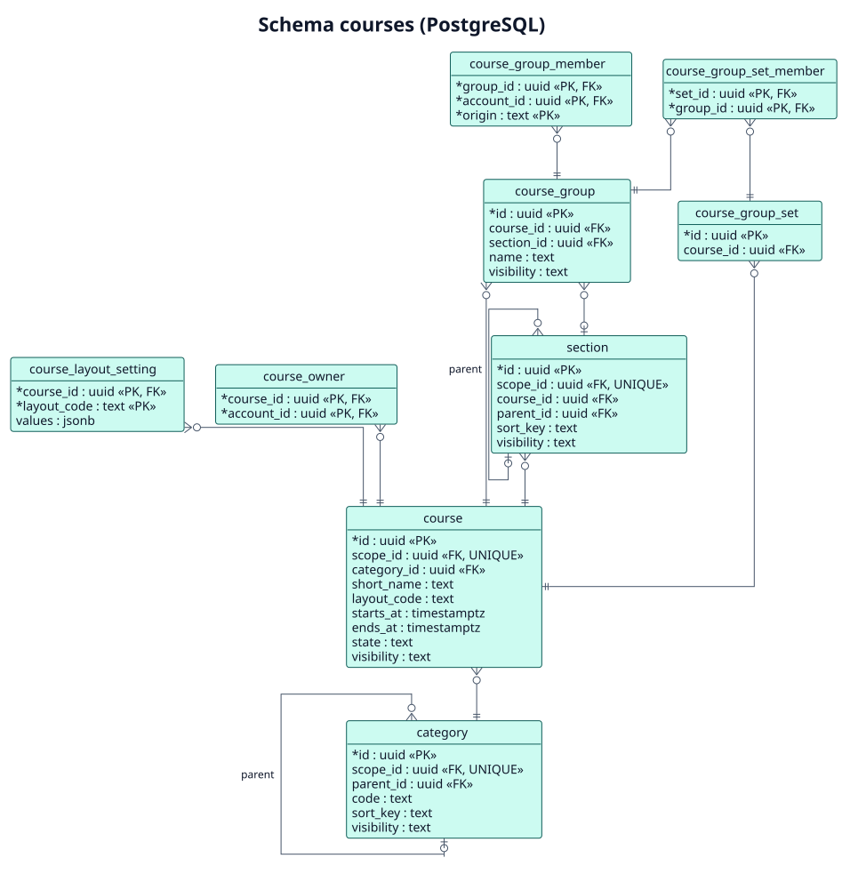

# Data model: courses

PostgreSQL schema `courses`, owned by `kampus-courses`, following DEC-014, DEC-021, DEC-022 and DEC-026. Rules refer to the [courses domain model](../../00-domain-model/courses.md). Names are logical; physically the schema carries the installation prefix, `kmp_courses` by default (DEC-039).

## Tables

| Table | Columns | Constraints and indexes |
| --- | --- | --- |
| `category` | `id`, `scope_id` FK → `access.scope` `UNIQUE`, `campus_id` FK → `access.scope`, `parent_id` FK → `category` (`RESTRICT`), `code`, `name`, `description`, `sort_key` text (`C` collation), `visibility`, `visible_from`, `visible_until`, `version` | partial `UNIQUE` (`campus_id`, lower(`code`)) where code is set; `UNIQUE` (`campus_id`, `parent_id`, `sort_key`) (`NULLS NOT DISTINCT`); index on `parent_id` |
| `course` | `id`, `scope_id` FK `UNIQUE`, `campus_id`, `category_id` FK → `category` (`RESTRICT`), `short_name`, `full_name`, `code`, `summary`, `layout_code`, `language_code` (nullable: forced language, RN-189; its FK → `i18n.language` arrives with that module), `starts_at`, `ends_at`, `state`, `state_changed_at`, `deletion_due_at`, `visibility`, `visible_from`, `visible_until`, `sort_key` (`C` collation), `version` | `UNIQUE` (`campus_id`, lower(`short_name`)); partial `UNIQUE` (`campus_id`, lower(`code`)); `CHECK` `ends_at` > `starts_at`; `CHECK` state in four values; `CHECK` `deletion_due_at` set exactly when the state is `deletion_scheduled`; `UNIQUE` (`category_id`, `sort_key`) |
| `course_layout_setting` | `course_id` FK (`CASCADE`), `layout_code`, `values` jsonb validated by the layout's declared schema | PK (`course_id`, `layout_code`); keeps the settings of each layout used, so switching back restores them (RN-052). Arrives with the first layout plugin that declares settings |
| `course_owner` | `course_id` FK (`CASCADE`), `account_id` FK → `identity.account` (`CASCADE`), `since` | PK (`course_id`, `account_id`) |
| `section` | `id`, `scope_id` FK `UNIQUE`, `course_id` FK (`CASCADE`), `parent_id`, `title`, `summary`, `sort_key` (`C` collation), `visibility`, `visible_from`, `visible_until`, `deleted_at`, `version` | `UNIQUE` (`id`, `course_id`); FK (`parent_id`, `course_id`) → `section` (`id`, `course_id`) (`CASCADE`), so a parent is always in the same course; no cycle, since moves go through the scope closure; `UNIQUE` (`course_id`, `parent_id`, `sort_key`) (`NULLS NOT DISTINCT`); index (`course_id`, `parent_id`) |
| `group` | `id`, `course_id` FK (`CASCADE`), `section_id` (nullable), `name`, `code`, `description`, `visibility`, `joining_key_hash`, `version` | `UNIQUE` (`id`, `course_id`); FK (`section_id`, `course_id`) → `section` (`CASCADE`), so the section is of the same course; `UNIQUE` (`course_id`, lower(`name`)); partial `UNIQUE` (`course_id`, lower(`code`)); `CHECK` visibility in four values |
| `group_member` | `group_id` FK → `group` (`CASCADE`), `account_id` FK → `identity.account` (`CASCADE`), `origin` (`manual`, or the name of the module that owns the membership), `added_at` | PK (`group_id`, `account_id`, `origin`): one row per origin, so each origin removes only its own (RN-054); index on `account_id` |
| `group_set` | `id`, `course_id` FK (`CASCADE`), `name`, `code` | `UNIQUE` (`id`, `course_id`); `UNIQUE` (`course_id`, lower(`name`)) |
| `group_set_group` | `set_id`, `group_id`, `course_id` | PK (`set_id`, `group_id`) (RN-058); FK (`set_id`, `course_id`) → `group_set` and FK (`group_id`, `course_id`) → `group` (`CASCADE`), so a set holds only groups of its course |
| `course_template` | `id`, `scope_id` FK → `access.scope` (campus or category), `code`, `layout_code`, `sections` jsonb (validated outline), `settings` jsonb (validated) | `UNIQUE` (`scope_id`, `code`). Arrives with customisation (T-C.15); until then a course starts with one untitled section |

Course modules are placed in sections by `kampus-activities`, which owns `activities.course_module (section_id FK → courses.section, sort_key)`; this schema never lists module identifiers (no list in a text column). Group mode is a setting of `kampus-settings`, resolved by scope (RN-057), not a column here.

## Effective visibility (RN-043)

`visibility` is `shown`, `hidden` or `scheduled` (with `visible_from` and `visible_until`). The effective visibility of a node is computed from the node and its ancestors in the scope closure: one query joins the ancestors and requires every one of them to be visible at `now()`. It is cached per scope subtree and invalidated by the `*_updated` and `*_moved` events. Nothing is ever written to the descendants.

## Ordering (RN-045, RN-046)

`sort_key` is a fractional index: a short text that sorts between its neighbours, so inserting or moving one node writes only that node. Keys are rebalanced, rarely, by a job that rewrites the keys of one parent in one transaction.

## Anti-patterns avoided (DEC-014)

| Avoided | How |
| --- | --- |
| Section position used as identity, renumbered on every move | Stable ids and fractional sort keys |
| List of module ids in a text column | Course modules reference their section |
| Visibility copied down with a one-level undo | Own visibility per node, effective visibility computed |
| Global sort order with limits per category | Order local to each parent |
| Format options as name and text value rows with a sentinel for "the course" | Typed layout settings validated by the layout's schema, per course |
| Group names unique only in forms; duplicate links in group sets | Unique constraints |
| Deletion right derived from the event log | Course owners as data, with a permission |

## Sort keys

Sort keys are texts of the 62 ASCII digits and letters, compared byte by byte (`C` collation), so the database and the service agree on their order whatever the collation of the installation. A key never ends with its smallest digit, so there is always a key between two others; `kampus_courses::support::sort_key` computes them.
