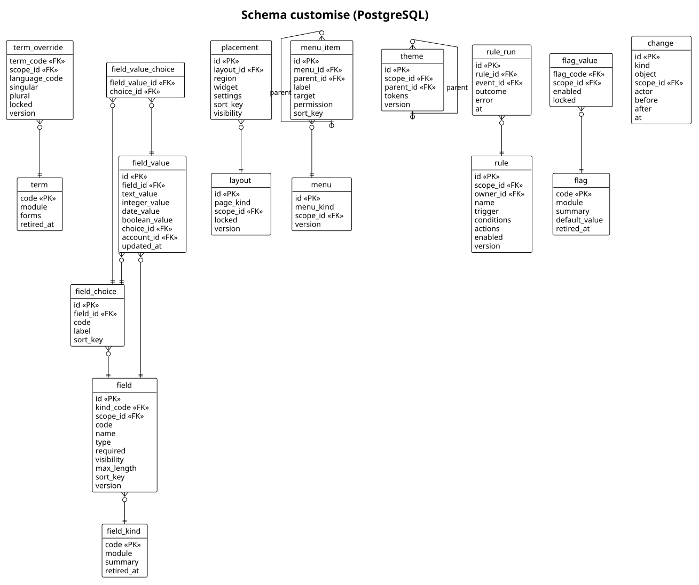

# Data model: customisation

PostgreSQL schema `customise`, owned by `kampus-customise`, following DEC-014, DEC-021, DEC-022 and DEC-026. Rules refer to the [customisation domain model](../../00-domain-model/customise.md). Names are logical; physically the schema carries the installation prefix, `kmp_customise` by default (DEC-039).

## Tables

| Table | Columns | Constraints and indexes |
| --- | --- | --- |
| `term` | `code` PK, `module`, `forms` jsonb (per language) | Synchronised from declarations (RN-212) |
| `term_override` | `term_code` FK → `term`, `scope_id` FK → `access.scope` (`CASCADE`), `language_code` FK → `i18n.language`, `forms` jsonb (validated) | PK (`term_code`, `scope_id`, `language_code`) |
| `field` | `id`, `entity_kind`, `scope_id` FK → `access.scope` (`CASCADE`), `code`, `type`, `validation` jsonb, `visibility`, `required`, `sort_key`, `version` | `UNIQUE` (`entity_kind`, `scope_id`, `code`) |
| `field_choice` | `id`, `field_id` FK (`CASCADE`), `code`, `label` jsonb, `sort_key` | `UNIQUE` (`field_id`, `code`) |
| `field_value` | `id`, `field_id` FK (`CASCADE`), `text_value`, `number_value` numeric, `date_value` timestamptz, `boolean_value`, `choice_id` FK → `field_choice`, `file_id` FK → `files.file`, `account_id` FK → `identity.account` | `CHECK` exactly the column of the field's type is set; owned through the owning module's link table (`<module>.<entity>_field`: entity FK with `CASCADE`, `field_value_id` FK with `CASCADE`, `UNIQUE` (entity, field)), so there is no polymorphic owner (RN-214) |
| `field_value_choice` | `field_value_id` FK → `field_value` (`CASCADE`), `choice_id` FK → `field_choice` (`CASCADE`) | PK (`field_value_id`, `choice_id`) |
| `layout` | `id`, `page_kind`, `scope_id` FK → `access.scope` (`CASCADE`), `locked`, `version` | `UNIQUE` (`page_kind`, `scope_id`) |
| `placement` | `id`, `layout_id` FK (`CASCADE`), `region`, `widget`, `settings` jsonb (validated by the widget), `sort_key`, `visibility` jsonb | Index (`layout_id`, `region`, `sort_key`) |
| `menu` | `id`, `menu_kind`, `scope_id` FK → `access.scope` (`CASCADE`), `version` | `UNIQUE` (`menu_kind`, `scope_id`) |
| `menu_item` | `id`, `menu_id` FK (`CASCADE`), `parent_id` FK → `menu_item` (`CASCADE`), `label` jsonb, `target`, `permission`, `sort_key` | |
| `theme` | `id`, `scope_id` FK → `access.scope` (`CASCADE`), `parent_id` FK → `theme`, `tokens` jsonb (validated, RN-217), `version` | `UNIQUE` (`scope_id`) |
| `rule` | `id`, `scope_id` FK → `access.scope` (`CASCADE`), `owner_id` FK → `identity.account`, `name`, `trigger` (event type), `conditions` jsonb (typed tree), `actions` jsonb (typed list), `enabled`, `version` | Index (`trigger`) where `enabled` |
| `rule_run` | `id`, `rule_id` FK (`CASCADE`), `event_id` FK → `events.event`, `outcome`, `error`, `at` | Index (`rule_id`, `at`); purged by retention |
| `flag` | `code` PK, `module`, `default_value` boolean | Synchronised from declarations |
| `flag_value` | `flag_code` FK (`CASCADE`), `scope_id` FK → `access.scope` (`CASCADE`), `enabled`, `locked` | PK (`flag_code`, `scope_id`) |
| `change` | `id`, `kind`, `object_id`, `scope_id`, `actor_id`, `before` jsonb, `after` jsonb, `at`, `package_checksum` | Append-only (RN-222) |

## Anti-patterns avoided (DEC-014)

| Avoided | How |
| --- | --- |
| Custom field values stored as text whatever their type | One typed column per type, with a check |
| Choices stored as newline-separated text in the field definition | A choice table with stable codes |
| Block placements addressed by page-type patterns and sub-page strings | A layout per page kind and scope, with typed placements |
| Rules written as code in plugins | Typed triggers, conditions and actions declared by modules |
