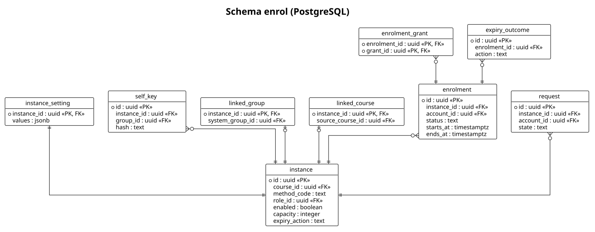

# Data model: enrolment

PostgreSQL schema `enrol`, owned by `kampus-enrol`, following DEC-014, DEC-021, DEC-022 and DEC-026. Rules refer to the [enrolment domain model](../../00-domain-model/enrolment.md). Names are logical; physically the schema carries the installation prefix, `kmp_enrol` by default (DEC-039).

## Tables

| Table | Columns | Constraints and indexes |
| --- | --- | --- |
| `instance` | `id`, `course_id` FK → `courses.course` (`CASCADE`), `section_id` FK → `courses.section` (`CASCADE`, nullable), `method_code`, `name`, `role_id` FK → `access.role` (`RESTRICT`), `enabled`, `open_from`, `open_until`, `default_duration` interval, `capacity` integer, `requires_approval`, `expiry_action`, `sort_key`, `version` | `CHECK` `open_until` > `open_from`; `CHECK` `capacity` > 0 when set; `CHECK` `expiry_action` in (`suspend`, `remove`, `keep_without_role`) |
| `instance_setting` | `instance_id` PK FK (`CASCADE`), `values` jsonb validated by the method's declared schema | Only for settings a method declares; nothing structural lives here |
| `self_key` | `id`, `instance_id` FK (`CASCADE`), `group_id` FK → `courses.group` (`CASCADE`, nullable), `hash` | `UNIQUE` (`instance_id`, `group_id`) `NULLS NOT DISTINCT` (RN-064) |
| `linked_group` | `instance_id` PK FK (`CASCADE`), `system_group_id` FK → `users.system_group` (`CASCADE`) | One source per instance (RN-067) |
| `linked_course` | `instance_id` PK FK (`CASCADE`), `source_course_id` FK → `courses.course` (`CASCADE`) | `CHECK` source differs from the instance's course; cycles refused by the service in a serialisable transaction (RN-067) |
| `enrolment` | `id`, `instance_id` FK (`CASCADE`), `account_id` FK → `identity.account`, `status`, `starts_at`, `ends_at`, `payment_ref`, `created_by`, `reason`, `version` | `UNIQUE` (`instance_id`, `account_id`) (RN-062); `CHECK` `ends_at` > `starts_at`; index (`account_id`, `status`) and (`instance_id`, `status`) |
| `enrolment_grant` | `enrolment_id` FK (`CASCADE`), `grant_id` FK → `access.grant` (`CASCADE`) | PK (`enrolment_id`, `grant_id`); the service removes the grant when the enrolment goes (RN-061) |
| `enrolment_group_member` | `instance_id` FK (`CASCADE`), `group_id`, `account_id`, FK (`group_id`, `account_id`, origin `module`) → `courses.group_member` (`CASCADE`) | Memberships owned by this instance (DEC-038) |
| `request` | `id`, `instance_id` FK (`CASCADE`), `account_id` FK, `message`, `state`, `decided_by`, `decided_at`, `reason` | partial `UNIQUE` (`instance_id`, `account_id`) where state is `pending` |
| `expiry_outcome` | `id`, `enrolment_id` FK (`CASCADE`), `action`, `at` | Append-only (RN-068) |
| `self_attempt` | `id`, `instance_id`, `account_id`, `address`, `outcome`, `at` | Throttling of key attempts (RN-064); purged after retention |

## Active participation (RN-060)

One query answers "is this person an active participant of this course": an `EXISTS` over `enrolment` joined to `instance` with `status = 'active'`, `enabled`, and `now()` (the database clock) within the period. Its result is cached per person and course for the request and invalidated by `enrol.*` events.

## Anti-patterns avoided (DEC-014)

| Avoided | How |
| --- | --- |
| Generic integer and text columns reused by every method for different meanings | Typed columns and typed link tables; a validated settings document only for what a method declares |
| Keys in clear text compared as strings, with hints | Hashes, constant-time comparison, no hints, throttling |
| Two sentinels for "forever" | `NULL` for open periods |
| Capacity checked by counting before inserting | Lock on the instance in the creating transaction |
| Roles of manual and self enrolments without an owner | Every enrolment owns its grants through `enrolment_grant` |
| Grades deleted when the last enrolment ends | Records and progress are never deleted by enrolment changes (RN-069) |
