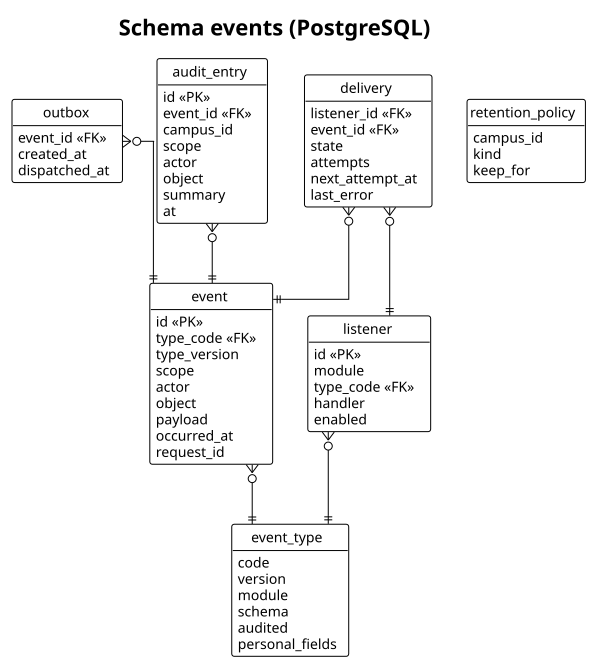

# Data model: events and audit log

PostgreSQL schema `events`, owned by `kampus-events`, following DEC-014, DEC-016, DEC-021 and DEC-022. Rules refer to the [events domain model](../../00-domain-model/events.md). Names are logical; physically the schema carries the installation prefix, `kmp_events` by default (DEC-039).

## Tables

| Table | Columns | Constraints and indexes |
| --- | --- | --- |
| `event_type` | `code` PK, `version`, `module`, `summary`, `fields` jsonb (the fields every payload has), `audited`, `personal_fields` jsonb, `retired_at` | Synchronised from declarations (DEC-015); a type no module declares is retired |
| `event` | `id`, `type_code` FK → `event_type`, `type_version`, `scope`, `actor`, `object`, `payload` jsonb (with its declared fields), `depth`, `request_id`, `occurred_at` | Index (`object`, `occurred_at`) and (`occurred_at`). `scope`, `actor` and `object` are not foreign keys on purpose: an event outlives what it is about. Partitioning by month arrives when volumes ask for it |
| `outbox` | `event_id` PK FK → `event` (`CASCADE`), `created_at`, `dispatched_at` | Partial index on undispatched rows; claimed with `FOR UPDATE SKIP LOCKED` |
| `listener` | `id`, `module`, `type_code` FK → `event_type`, `name`, `enabled`, `retired_at` | `UNIQUE` (`module`, `type_code`, `name`) |
| `delivery` | `listener_id` FK (`CASCADE`), `event_id` FK (`CASCADE`), `object`, `occurred_at`, `state` (`pending`, `done`, `dead`), `attempts`, `next_attempt_at`, `lease_until`, `last_error`, `done_at` | PK (`listener_id`, `event_id`); index (`state`, `next_attempt_at`) and (`listener_id`, `object`, `occurred_at`) for the order per object (RN-140) |
| `audit_entry` | `id`, `event_id` FK → `event` (`RESTRICT`) `UNIQUE`, `campus`, `scope`, `actor`, `object`, `summary`, `at` | Append-only: a trigger refuses updates, and deletes outside the retention job; index (`scope`, `at`) and (`actor`, `at`) |
| `retention_policy` | `campus_id`, `kind` (`audit`, `event_payload`), `keep_for` interval | PK (`campus_id`, `kind`). Arrives with settings; until then events are kept 90 days and audit entries two years |

## Anti-patterns avoided (DEC-014)

| Avoided | How |
| --- | --- |
| Log rows buffered in memory and written after the request | Audit entries in the change's transaction |
| Serialised PHP data in log columns | Payloads validated by a declared JSON schema |
| Observer failures caught and printed as debugging | Deliveries with state, retries and a dead-letter list |
| Retention "never delete" by default | A retention policy per campus |
