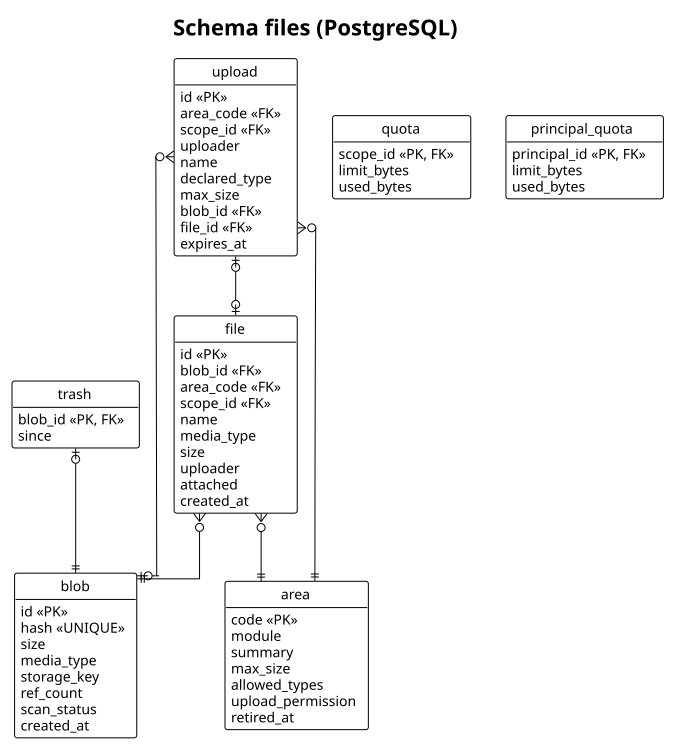

# Data model: files

PostgreSQL schema `files`, owned by `kampus-files`, following DEC-014, DEC-021, DEC-022 and DEC-026. Rules refer to the [files domain model](../../00-domain-model/files.md). Names are logical; physically the schema carries the installation prefix, `kmp_files` by default (DEC-039).

## Tables

| Table | Columns | Constraints and indexes |
| --- | --- | --- |
| `blob` | `id`, `hash` bytea, `size` bigint, `media_type` (read from the content when it was first stored), `storage_key` (`sha256/…` in the storage port), `ref_count` integer, `scan_status` (`unscanned`, `pending`, `clean`, `infected`, `failed`), `created_at` | `UNIQUE` (`hash`) (RN-126); `CHECK` `ref_count` >= 0; `clean` once a scanner found nothing, `unscanned` without a scanner; infected content is never stored |
| `area` | `code` PK, `module`, `summary`, `max_size` bigint, `allowed_types` jsonb (exact types or families such as `image/*`), `upload_permission`, `retired_at` | Synchronised from module declarations (DEC-015) |
| `file` | `id`, `blob_id` FK → `blob` (`RESTRICT`), `area_code` FK → `area` (`RESTRICT`), `scope_id` FK → `access.scope` (`CASCADE`, the scope it was uploaded for), `name`, `media_type`, `size`, `uploader` (soft: outlives the account), `attached`, `created_at` | Owned through the owning module's link table (`<module>.<entity>_file`, with foreign keys and `CASCADE` from the owner, RN-127); until `attached`, only its uploader reads it; index on `blob_id` and (`attached`, `created_at`) for the purge |
| `upload` | `id`, `area_code` FK → `area` (`CASCADE`), `scope_id` FK → `access.scope` (`CASCADE`), `uploader`, `name`, `declared_type` (a hint only, RN-130), `max_size`, `blob_id` FK → `blob` (`CASCADE`, once the content arrived), `file_id` FK → `file` (`CASCADE`, once completed), `expires_at` (one hour), `created_at` | Only its uploader sends to it; the purge job removes it after expiry |
| `trash` | `blob_id` PK FK → `blob` (`CASCADE`), `since` | Content no file uses: new content waits here until a file uses it, and content whose last file is detached comes back; the purge job deletes it from storage after 7 days (RN-133) |
| `quota` | `scope_id` PK FK → `access.scope` (`CASCADE`), `limit_bytes` (none: no limit), `used_bytes` (step 2) | `CHECK` both >= 0; an attached file counts in every scope of its path, from its own up to the platform, in the transaction that attaches or detaches it; the check rides in the same `UPDATE`, so two attachments at once cannot both pass a limit (RN-134) |
| `principal_quota` | `principal_id` PK FK → `access.principal` (`CASCADE`), `limit_bytes`, `used_bytes` (step 2) | The same for the person who uploaded each file |
| `conversion` | `id`, `source_blob_id` FK → `blob` (`CASCADE`), `kind` (`thumbnail`), `state` (`queued`, `done`, `failed`), `result_blob_id` FK → `blob` (`RESTRICT`), `error`, `created_at` | `UNIQUE` (`source_blob_id`, `kind`): a conversion belongs to the content, so every file with it shares it; the job `files.convert` makes it the first time it is asked for and publishes `files.converted`; its result is content of its own, counted as one use, released when the source is deleted; a failure is kept and not retried (RN-135) |

Opening an upload checks that the file would fit every quota it would count in, and refuses it with `files.quota_exceeded`; files nobody attached never count, since they are removed within a day. With a scanner configured (`KAMPUS_SCAN_URL`), every upload is scanned before it is kept and infected content is refused with `files.infected`; without one, blobs stay `unscanned`. Thumbnails decode within limits (12 000 pixels a side, 256 MB), so a crafted image cannot exhaust a worker; the original is never changed. `kampus-server copy-storage <url>` copies every blob to another store, verifying each by its hash, before the operator switches `KAMPUS_STORAGE_URL` (RN-136).

Links to files and to their conversions last five minutes (RN-131). When the store signs links at its public address (`KAMPUS_STORAGE_PUBLIC_URL`) and the content cannot run (raster images, PDF, audio, video and plain text), the link is one the store signs, answered with the media type of the blob, an inline disposition with the name of the file and private caching for the life of the link, so browsers read it from the store directly. Everything else, and every file when the store signs no links, is read through `/api/v1/files/content/{id}`, behind a signature of the file and the expiry, with `nosniff`, a sandboxing content security policy and an attachment for active content, headers a store cannot set (RN-132).

## Anti-patterns avoided (DEC-014)

| Avoided | How |
| --- | --- |
| A file row addressed by context, component, area and item id (polymorphic) | Files owned through the owner module's link table |
| Reference count computed by a query after the delete | Count maintained in the same transaction |
| Each component checking permissions in its own callback | One rule: readable when the owner is readable (RN-128) |
| Tokens that never expire for file access | Signed URLs of a few minutes for one file |
| Upload paths with different checks | One upload pipeline for every client |
