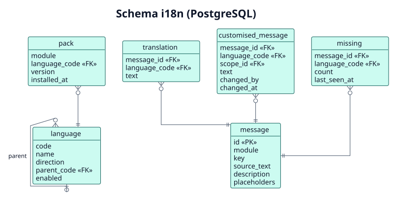

# Data model: languages

PostgreSQL schema `i18n`, owned by `kampus-i18n`, following DEC-014, DEC-021, DEC-022 and DEC-026. Rules refer to the [languages domain model](../../00-domain-model/languages.md). Names are logical; physically the schema carries the installation prefix, `kmp_i18n` by default (DEC-039).

## Tables

| Table | Columns | Constraints and indexes |
| --- | --- | --- |
| `language` | `code` PK (BCP 47), `name` jsonb, `direction` (`ltr`, `rtl`), `parent_code` FK → `language`, `enabled` | |
| `message` | `id`, `module`, `key`, `source_text`, `description`, `placeholders` text[] | `UNIQUE` (`module`, `key`) |
| `pack` | `module`, `language_code` FK → `language`, `version`, `installed_at` | PK (`module`, `language_code`) |
| `translation` | `message_id` FK (`CASCADE`), `language_code` FK, `text` | PK (`message_id`, `language_code`); placeholders checked on insert (RN-188) |
| `customised_message` | `message_id` FK (`CASCADE`), `language_code` FK, `scope_id` FK → `access.scope` (`CASCADE`), `text`, `changed_by`, `changed_at` | PK (`message_id`, `language_code`, `scope_id`) |
| `language_choice` | `account_id` FK → `identity.account` (`CASCADE`, nullable), `course_id` FK → `courses.course` (`CASCADE`, nullable), `language_code` FK, `forced` | `CHECK` exactly one of `account_id` and `course_id`; `UNIQUE` on each |
| `missing` | `message_id` FK (`CASCADE`), `language_code` FK, `count`, `last_seen_at` | PK (`message_id`, `language_code`) |

## Anti-patterns avoided (DEC-014)

| Avoided | How |
| --- | --- |
| Strings stitched together from pieces in code | ICU messages with placeholders |
| Customisations lost when a pack is updated | Customised messages kept apart from translations |
| Missing strings found by users | Counted per pack and language |
