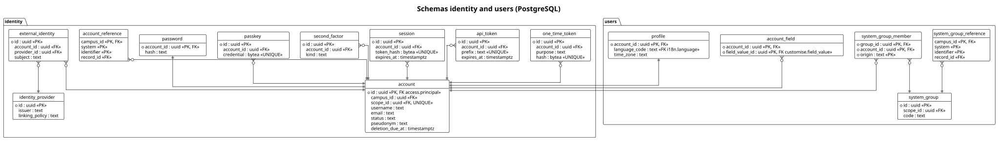

# Data model: identity and users

PostgreSQL schemas `identity` (owned by `kampus-identity`) and `users` (owned by `kampus-users`), following DEC-014, DEC-021, DEC-022 and DEC-026. Rules refer to the [identity domain model](../../00-domain-model/identity.md).

## Schema `identity`

| Table | Columns | Constraints and indexes |
| --- | --- | --- |
| `account` | `id`, `campus_id` FK → `access.scope`, `scope_id` FK → `access.scope` `UNIQUE` (the user scope), `kind` (`person`, `service`), `username`, `email`, `email_verified_at`, `status`, `status_reason`, `status_changed_at`, `status_changed_by`, `last_sign_in_at`, `pseudonym`, `deleted_at`, `version` | `UNIQUE` (`campus_id`, lower(`username`)); partial `UNIQUE` (`campus_id`, lower(`email`)) where status ≠ `deleted`; `CHECK` status in the five states; `CHECK` service accounts have no email requirement |
| `account_transition` | `id`, `account_id` FK (`CASCADE`), `from_status`, `to_status`, `reason`, `actor_id`, `at` | Append-only history of RN-023 |
| `password` | `account_id` PK FK (`CASCADE`), `hash`, `algorithm_params`, `set_at`, `must_change` | One row per account |
| `passkey` | `id`, `account_id` FK (`CASCADE`), `credential_id` `UNIQUE`, `public_key`, `sign_count`, `label`, `last_used_at` | WebAuthn credential, usable as first or second factor |
| `identity_provider` | `id`, `campus_id` FK → `access.scope`, `kind` (`oidc`; later `saml`, `ldap`), `issuer`, `client_id`, `client_secret_encrypted`, `claim_mapping` jsonb (validated schema), `linking_policy` (`subject_only`, `verified_email`, `confirm`) | `UNIQUE` (`campus_id`, `issuer`) |
| `external_identity` | `id`, `account_id` FK (`CASCADE`), `provider_id` FK (`CASCADE`), `subject`, `email_at_link`, `linked_at`, `last_used_at` | `UNIQUE` (`provider_id`, `subject`) (RN-028) |
| `second_factor` | `id`, `account_id` FK (`CASCADE`), `kind` (`totp`, `passkey`, `email`), `secret_encrypted` (TOTP), `passkey_id` FK → `passkey`, `label`, `created_at`, `last_used_at` | `CHECK` the column of its kind is set |
| `recovery_code` | `id`, `account_id` FK (`CASCADE`), `hash`, `used_at` | Generated in sets of ten |
| `one_time_token` | `id`, `account_id` FK (`CASCADE`), `purpose` (`confirm_email`, `invitation`, `set_password`, `recovery`, `email_code`), `hash` `UNIQUE`, `expires_at`, `used_at` | `CHECK` `expires_at` > `created_at`; index on `expires_at` for purging |
| `session` | `id`, `account_id` FK (`CASCADE`), `token_hash` `UNIQUE`, `mfa_level`, `strong_auth_at`, `created_at`, `last_seen_at`, `expires_at`, `client`, `address` | Index (`account_id`); revocation is a delete by `account_id` (RN-031) |
| `api_token` | `id`, `account_id` FK (`CASCADE`), `name`, `prefix` `UNIQUE`, `hash`, `scopes` (rows in `api_token_scope`), `expires_at`, `last_used_at`, `revoked_at` | `CHECK` `expires_at` set |
| `api_token_scope` | `token_id` FK (`CASCADE`), `permission_code` FK → `access.permission`, `scope_id` FK → `access.scope` | PK (`token_id`, `permission_code`, `scope_id`) |
| `sign_in_attempt` | `id`, `campus_id`, `account_id` (nullable), `name_tried_hash`, `address`, `outcome`, `at` | Indexes for throttling by account and by address; purged after the retention period |

**Deletion keeps the row as a tombstone** (RN-034): the privacy handlers of every module erase their personal data, then the account row itself has `username`, `email` and every personal column set to `NULL`, `pseudonym` set, and status `deleted`. Its id never changes, so foreign keys from academic records and contributions stay valid. A `CHECK` requires `username` unless the status is `deleted`, and `pseudonym` when it is.

## Schema `users`

| Table | Columns | Constraints and indexes |
| --- | --- | --- |
| `profile` | `account_id` PK FK → `identity.account` (`CASCADE`), `given_name`, `family_name`, `display_name`, `locale`, `time_zone`, `picture_file_id` FK → `files.file`, `version` | `CHECK` locale is a BCP 47 tag, time zone an IANA name |
| `profile_field` | `id`, `scope_id` FK → `access.scope` (campus or category), `code`, `type` (`text`, `number`, `date`, `choice`, `boolean`), `options` jsonb (validated), `required`, `visibility` (`self`, `roles`, `nobody`), `editable_by` (`self`, `roles`), `sort` | `UNIQUE` (`scope_id`, `code`) |
| `profile_field_value` | `account_id` FK (`CASCADE`), `field_id` FK (`CASCADE`), `value` typed by field (one column per type, `CHECK` exactly one set) | PK (`account_id`, `field_id`) |
| `preference` | `account_id` FK (`CASCADE`), `key` (declared by a module), `value` jsonb (validated by its declaration) | PK (`account_id`, `key`) |
| `system_group` | `id`, `scope_id` FK → `access.scope`, `code`, `name`, `kind` (`manual`, `rule`), `rule` jsonb (validated), `owner_module` | `UNIQUE` (`scope_id`, `code`) |
| `system_group_member` | `group_id` FK (`CASCADE`), `account_id` FK (`CASCADE`), `origin` (`manual`, `rule`, `sync`), `added_at` | PK (`group_id`, `account_id`, `origin`) (RN-037) |

## Anti-patterns avoided (DEC-014)

| Avoided | How |
| --- | --- |
| Secrets in clear text (reset tokens, confirmation secrets, provider secrets) | Hashes for tokens, encryption for secrets that must be read back |
| Linking external accounts by the first matching email | Unique (`provider_id`, `subject`); email linking only by policy |
| Lockout state in generic preferences | `sign_in_attempt` records with their own retention |
| Soft deletion that keeps personal data | Erasure plus tombstone with a pseudonym |
| Suspension that leaves sessions alive | Server-side sessions revoked with the status change |
| One wide user table for every field | Profile, typed custom fields, and preferences declared by modules |
