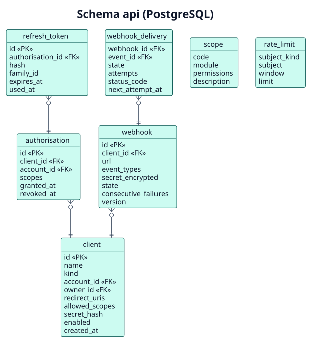

# Data model: integrations

PostgreSQL schema `api`, owned by `kampus-api`, following DEC-014, DEC-021, DEC-022 and DEC-026. Rules refer to the [integrations domain model](../../00-domain-model/integrations.md). Names are logical; physically the schema carries the installation prefix, `kmp_api` by default (DEC-039).

## Tables

| Table | Columns | Constraints and indexes |
| --- | --- | --- |
| `client` | `id`, `name`, `kind` (`service`, `oauth`), `account_id` FK → `identity.account` (service accounts), `owner_id` FK → `identity.account`, `redirect_uris` text[], `allowed_scopes` text[], `secret_hash`, `enabled`, `created_at` | `CHECK` service clients have an account |
| `scope` | `code` PK, `module`, `permissions` text[], `description` jsonb | Synchronised from declarations (RN-195) |
| `authorisation` | `id`, `client_id` FK (`CASCADE`), `account_id` FK (`CASCADE`), `scopes` text[], `granted_at`, `revoked_at` | Partial `UNIQUE` (`client_id`, `account_id`) where not revoked |
| `refresh_token` | `id`, `authorisation_id` FK (`CASCADE`), `hash` `UNIQUE`, `family_id`, `expires_at`, `used_at` | Reuse of a used token revokes its family (RN-197) |
| `rate_limit` | `subject_kind`, `subject`, `window` interval, `limit` integer | PK (`subject_kind`, `subject`); counters live on the cache port |
| `webhook` | `id`, `client_id` FK (`CASCADE`), `url`, `event_types` text[], `secret_encrypted` bytea, `state` (`active`, `disabled`), `consecutive_failures`, `version` | Index (`state`) |
| `webhook_delivery` | `webhook_id` FK (`CASCADE`), `event_id` FK → `events.event`, `state`, `attempts`, `status_code`, `next_attempt_at` | PK (`webhook_id`, `event_id`) |

## Anti-patterns avoided (DEC-014)

| Avoided | How |
| --- | --- |
| Tokens that grant everything the account can do | Scopes intersected with permissions |
| Functions exposed by listing them by hand | Routes declared by modules, document generated |
| Webhooks fired inside the request | Deliveries after commit with retries |
