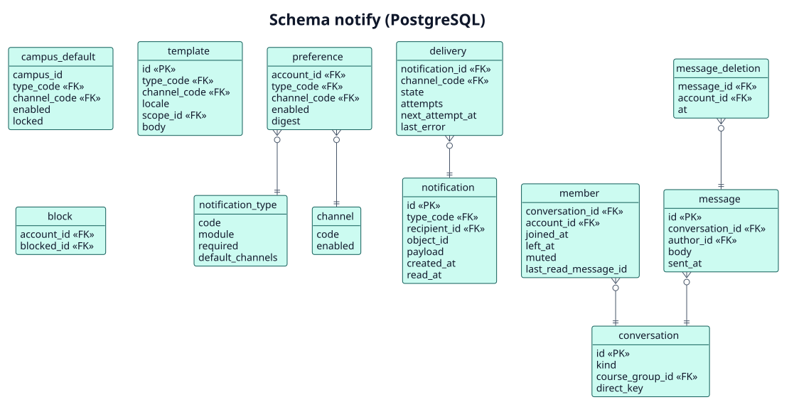

# Data model: notifications and messaging

PostgreSQL schema `notify`, owned by `kampus-notify`, following DEC-014, DEC-021, DEC-022 and DEC-026. Rules refer to the [notifications domain model](../../00-domain-model/notify.md). Names are logical; physically the schema carries the installation prefix, `kmp_notify` by default (DEC-039).

## Tables

| Table | Columns | Constraints and indexes |
| --- | --- | --- |
| `notification_type` | `code` PK, `module`, `required` boolean, `default_channels` text[] | Synchronised from declarations |
| `preference` | `account_id` FK → `identity.account` (`CASCADE`), `type_code` FK → `notification_type`, `channel_code` FK → `channel`, `enabled`, `digest` (`none`, `daily`, `weekly`) | PK (`account_id`, `type_code`, `channel_code`) |
| `campus_default` | `campus_id` FK → `access.scope` (`CASCADE`), `type_code` FK (`CASCADE`), `channel`, `enabled`, `locked` | PK (`campus_id`, `type_code`, `channel`); a locked default wins over the person (step 2) |
| `template` | `id`, `campus_id` FK → `access.scope` (`CASCADE`), `type_code` FK (`CASCADE`), `channel` (`email`, `push`), `locale`, `subject`, `body` | `UNIQUE` (`campus_id`, `type_code`, `channel`, `locale`); placeholders `{{name}}` from the payload and `{{summary}}` |
| `delivery` | `notification_id` FK (`CASCADE`), `channel` (`email`, `push`), `state` (`pending`, `sent`, `dead`), `attempts`, `next_attempt_at`, `last_error`, `sent_at` | PK (`notification_id`, `channel`); index (`state`, `next_attempt_at`); taken by the job `notify.deliver` with `FOR UPDATE SKIP LOCKED`, tried again with a growing wait and given up after 5 attempts |
| `push_subscription` | `id`, `account_id` FK → `identity.account` (`CASCADE`), `endpoint` `UNIQUE`, `p256dh`, `auth`, `created_at` | The browsers and phones of a person |
| `notification` | `id`, `type_code` FK, `recipient_id` FK → `identity.account` (`CASCADE`), `object_id`, `payload` jsonb (validated), `created_at`, `read_at` | Index (`recipient_id`, `read_at`, `created_at`) |
| `conversation` | `id`, `campus_id` FK → `access.scope` (`CASCADE`), `kind` (`direct`, `group`, `course_group`), `title` (groups), `direct_key` text, `course_group_id` FK → `courses.group` (`CASCADE`, nullable), `created_by` FK → `identity.account` (`SET NULL`), `created_at` | `UNIQUE` (`direct_key`) for direct ones (ordered pair of account ids, so opening it twice or from both sides finds the same one); `UNIQUE` (`course_group_id`) |
| `member` | `conversation_id` FK (`CASCADE`), `account_id` FK → `identity.account` (`CASCADE`), `joined_at`, `left_at`, `muted`, `last_read_at` | PK (`conversation_id`, `account_id`); the members of the conversation of a group are made those of the group each time it is read or written |
| `message` | `id`, `conversation_id` FK (`CASCADE`), `author_id` FK → `identity.account` (`CASCADE`), `body` (sanitised rich text), `sent_at` | Index (`conversation_id`, `sent_at`), index (`author_id`) |
| `message_deletion` | `message_id` FK (`CASCADE`), `account_id` FK (`CASCADE`), `at` | PK (`message_id`, `account_id`); the job `notify.message_purge` purges messages every member deleted, and those older than `notify.message_retention_days` of their campus (RN-154) |
| `block` | `account_id` FK (`CASCADE`), `blocked_id` FK (`CASCADE`), `created_at` | PK (`account_id`, `blocked_id`); a block stops writing either way, and the refusal never says who blocked whom |

The first part of notify (step 1) creates `notification_type` (code, module, summary, `channels`, `required`, `retired_at`), `notification` (with a `dedupe` key so a listener that runs twice for one event notifies once: `UNIQUE` (`recipient_id`, `type_code`, `dedupe`)) and `preference` (PK `account_id`, `type_code`, `channel`). Step 2 adds the channels email and push (fixed in code: `inbox`, `email`, `push`), `in_inbox` on `notification`, `delivery`, `template`, `campus_default` and `push_subscription`: what a person receives of a type on a channel is a locked default of their campus, else their own choice, else the default of the campus, else the channels the type declares, and a required type always reaches the inbox; email and push are sent by the job `notify.deliver` through a transport per channel (the server logs them until a transport is configured). Step 3 adds conversations, members, messages, deletions and blocks: who may write to whom follows `notify.messaging` of the campus (`course`, people who take part in a course together, by default; `campus`; `nobody`), which `notify.message.anyone` overrides; message bodies are sanitised rich text (DEC-024), and each message notifies the other members who did not mute the conversation with `notify.message_received`. Types are declared by modules (`Module.notification_types`) and created by listeners after the change commits; a grade is announced only when the person may see it, decided by the records visibility service.

## Anti-patterns avoided (DEC-014)

| Avoided | How |
| --- | --- |
| Preferences as concatenated names with comma lists of processors | Typed preference rows per type and channel |
| Mail sent inside the sender's request | One delivery job per recipient and channel |
| One-to-one conversations de-duplicated by read-then-insert on a non-unique hash | Unique key on the ordered pair |
| Messages kept forever after every member deleted them | Purge job and retention policy |
