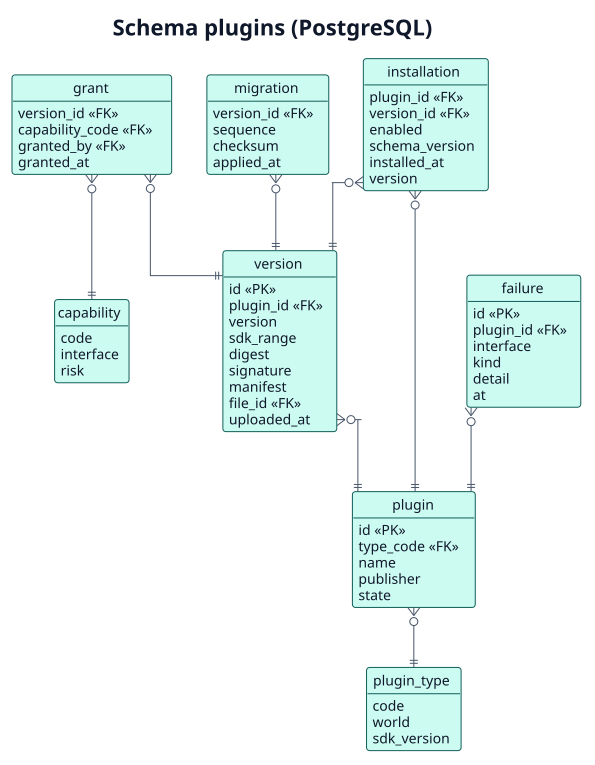

# Data model: plugins

PostgreSQL schema `plugins`, owned by `kampus-plugin-host`, following DEC-014, DEC-021, DEC-022 and DEC-026. Rules refer to the [plugins domain model](../../00-domain-model/plugins.md). Names are logical; physically the schema carries the installation prefix, `kmp_plugins` by default (DEC-039).

## Tables

| Table | Columns | Constraints and indexes |
| --- | --- | --- |
| `plugin_type` | `code` PK, `world`, `sdk_version` | Synchronised from the host |
| `plugin` | `id` (reverse-domain text) PK, `type_code` FK → `plugin_type`, `name` jsonb, `publisher`, `state` | |
| `version` | `id`, `plugin_id` FK → `plugin` (`CASCADE`), `version`, `sdk_range`, `digest` bytea, `signature` bytea, `manifest` jsonb (validated), `file_id` FK → `files.file`, `uploaded_at` | `UNIQUE` (`plugin_id`, `version`) |
| `capability` | `code` PK, `interface`, `risk` (`low`, `medium`, `high`) | |
| `grant` | `version_id` FK → `version` (`CASCADE`), `capability_code` FK → `capability`, `granted_by` FK → `identity.account`, `granted_at` | PK (`version_id`, `capability_code`) |
| `installation` | `plugin_id` PK FK → `plugin` (`CASCADE`), `version_id` FK → `version`, `enabled`, `schema_version`, `installed_at`, `version` (row) | One installation per plugin |
| `migration` | `version_id` FK → `version` (`CASCADE`), `sequence`, `checksum` bytea, `applied_at` | PK (`version_id`, `sequence`) |
| `failure` | `id`, `plugin_id` FK → `plugin` (`CASCADE`), `interface`, `kind` (`trap`, `fuel`, `memory`, `timeout`), `detail`, `at` | Index (`plugin_id`, `at`); purged by retention |

The plugin's own tables live in a schema per plugin (`kmp_plugin_<short id>` by default), created and migrated by the host from the plugin's neutral schema (RN-206, DEC-065).

## Anti-patterns avoided (DEC-014)

| Avoided | How |
| --- | --- |
| Plugins writing to any table of the platform | Own schema only; everything else through host interfaces |
| Upgrade steps written as free code that can fail half-way | Forward-only migrations, one transaction per step, with checksums |
| Plugin versions stored only as a number in a configuration table | Versions with digest, signature and manifest |
