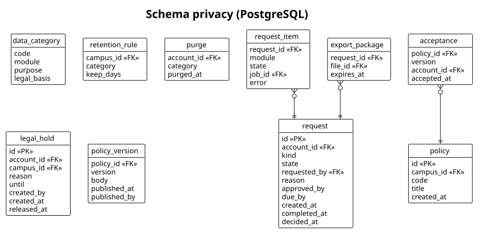

# Data model: privacy

PostgreSQL schema `privacy`, owned by `kampus-privacy`, following DEC-014, DEC-021, DEC-022 and DEC-026. Rules refer to the [privacy domain model](../../00-domain-model/privacy.md). Names are logical; physically the schema carries the installation prefix, `kmp_privacy` by default (DEC-039).

## Tables

| Table | Columns | Constraints and indexes |
| --- | --- | --- |
| `data_category` | `code` PK, `module`, `purpose`, `legal_basis` | Synchronised from privacy handlers (RN-178) |
| `request` | `id`, `account_id` FK → `identity.account`, `kind` (`export`, `deletion`), `state` (`pending`, `approved`, `running`, `held`, `completed`, `rejected`, `failed`), `requested_by` FK → `identity.account`, `reason`, `approved_by`, `due_by`, `created_at`, `completed_at` | Partial `UNIQUE` (`account_id`, `kind`) for open requests; index (`state`, `due_by`) |
| `request_item` | `request_id` FK (`CASCADE`), `module`, `state`, `job_id` FK → `tasks.job`, `error` | PK (`request_id`, `module`) |
| `retention_rule` | `campus_id` FK → `access.scope` (`CASCADE`), `category`, `keep_days` | PK (`campus_id`, `category`); `CHECK` `keep_days` > 0 |
| `purge` | `account_id` FK → `identity.account` (`CASCADE`), `category`, `purged_at` | PK (`account_id`, `category`) |
| `legal_hold` | `id`, `account_id` FK → `identity.account` (nullable, `CASCADE`), `campus_id` FK → `access.scope` (nullable, `CASCADE`), `reason`, `until`, `created_by` (soft), `created_at`, `released_at` | `CHECK` exactly one of `account_id` and `campus_id` |
| `policy` | `id`, `campus_id` FK → `access.scope`, `code`, `title`, `created_at` | `UNIQUE` (`campus_id`, `code`) |
| `policy_version` | `policy_id` FK (`CASCADE`), `version`, `body`, `published_at`, `published_by` (soft) | PK (`policy_id`, `version`) |
| `acceptance` | `policy_id`, `version` FK → `policy_version` (`CASCADE`), `account_id` FK → `identity.account` (`CASCADE`), `accepted_at` | PK (`policy_id`, `version`, `account_id`) |
| `export_package` | `request_id` FK (`CASCADE`), `file_id` FK → `files.file`, `expires_at` | PK (`request_id`, `file_id`) |

The first part of privacy (step 1) creates `request` (account, `requester` as a soft reference, kind, state `pending`, `completed`, `failed` or `expired`, `due_at`, `expires_at`) and `request_item` (one per data category, with the exported `data` as JSON until the package expires, the state and the error). Exports are answered by the handlers modules declare (`Module.privacy_handlers`: category, purpose, `export`); today records, progress, notify and calendar declare one each. The second part (step 2) creates `policy`, `policy_version` and `acceptance`: a campus publishes a policy in numbered versions and a person accepts the latest one; the acceptances are exported through the handler `privacy.acceptances` that privacy itself declares. The third part (step 3) widens the states of `request` (`awaiting_approval`, `held`, `rejected`), adds `reason`, `approved_by` and `decided_at`, and creates `legal_hold`. A deletion request waits for someone with `privacy.request.approve` unless whoever asks holds it; once approved, every handler erases its data (`erase`: notify and calendar delete, records, progress and privacy keep their rows, which point to the tombstone) and identity leaves the account as a tombstone with a pseudonym. An active hold, on the account or on its campus, keeps the request in `held` until it is released or ends. The fourth part (step 4) creates `retention_rule` and `purge`: a campus says how many days after an account is deleted each data category that an erasure keeps is purged, and a daily job asks the handler to purge it (`PrivacyRun.purge`) unless a hold covers the account; `purge` records what was purged so it never repeats. Packages as files arrive in a later part.

## Anti-patterns avoided (DEC-014)

| Avoided | How |
| --- | --- |
| Deletion that removes the account row and breaks every reference | The tombstone of RN-034 |
| Modules forgotten by the export | A handler declared per module, checked by the build |
| Retention expressed per screen | Declared categories with rules per campus |
