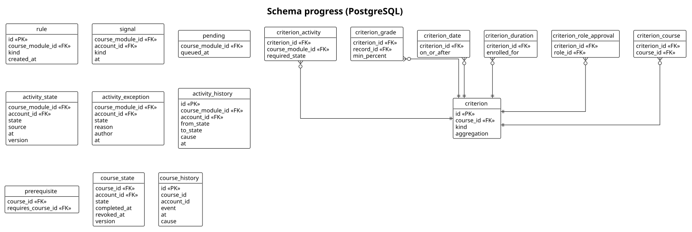

# Data model: progress

PostgreSQL schema `progress`, owned by `kampus-progress`, following DEC-014, DEC-021, DEC-022 and DEC-026. Rules refer to the [progress domain model](../../00-domain-model/progress.md). Names are logical; physically the schema carries the installation prefix, `kmp_progress` by default (DEC-039).

## Tables

| Table | Columns | Constraints and indexes |
| --- | --- | --- |
| `rule` | `id`, `course_module_id` FK → `activities.course_module` (`CASCADE`), `kind` (`manual`, `view`, `submit`, `grade`, `pass`), `created_at`; `type_rule_code` and `parameters` arrive with the rules types declare | `UNIQUE` (`course_module_id`, `kind`) |
| `activity_state` | `course_module_id` FK (`CASCADE`), `account_id` FK → `identity.account` (`CASCADE`), `state`, `source` (`automatic`, `exception`), `at`, `version` | PK (`course_module_id`, `account_id`); `CHECK` state in the five values (RN-115); a person who has not started has no row |
| `activity_exception` | `course_module_id` FK (`CASCADE`), `account_id` FK (`CASCADE`), `state`, `reason`, `author` (soft reference to the account that decided it), `at` | PK (`course_module_id`, `account_id`) (RN-119) |
| `activity_history` | `id`, `course_module_id` FK (`CASCADE`), `account_id` FK (`CASCADE`), `from_state`, `to_state`, `cause`, `at` | Append-only; index (`course_module_id`, `account_id`, `at`) |
| `signal` | `course_module_id` FK (`CASCADE`), `account_id` FK (`CASCADE`), `kind` (`view`, `submit`, `manual`), `at` | PK (`course_module_id`, `account_id`, `kind`); what a person did, kept so the state can be re-evaluated when the rules change |
| `pending` | `course_module_id` PK FK (`CASCADE`), `queued_at` | The course modules whose rules changed and wait for the job `progress.recalculate`, which takes them with `FOR UPDATE SKIP LOCKED` and re-evaluates everyone who did something or has a grade (RN-118) |
| `condition_state` | `condition_id` PK FK → `activities.condition` (`CASCADE`), `course_module_id` FK → `activities.course_module` (`CASCADE`), `required` (`done`, `not_done`, `passed`, `failed`) | The kind `progress.state` (step 2): the state another course module of the course reached, read as kept whatever the person may see of it; activities asks for its leaves before deleting that course module |
| `course_setting` | `course_id` PK FK → `courses.course` (`CASCADE`), `aggregation` (`all`, `any`), `final`, `updated_at` | How the criteria of a course combine, and whether a completion stays when a criterion stops being met |
| `criterion` | `id`, `course_id` FK → `courses.course` (`CASCADE`), `kind` (`activity`, `grade`, `date`, `duration`, `role_approval`, `course`), `position` | Index (`course_id`, `position`); one leaf in the table of its kind; a criterion that stays the same when the criteria are replaced keeps its id and its approvals |
| `criterion_activity` | `criterion_id` PK FK (`CASCADE`), `course_module_id` FK → `activities.course_module` (`CASCADE`), `required` (`done`, `passed`) | |
| `criterion_grade` | `criterion_id` PK FK (`CASCADE`), `record_id` FK → `records.record` (`CASCADE`), `min_percent` | The grade as a share of the range of the record, read as kept |
| `criterion_date` | `criterion_id` PK FK (`CASCADE`), `on_or_after` | |
| `criterion_duration` | `criterion_id` PK FK (`CASCADE`), `enrolled_days` | Days taking part without a break, from the start of the active enrolments |
| `criterion_role_approval` | `criterion_id` PK FK (`CASCADE`), `role_id` FK → `access.role` (`CASCADE`) | |
| `criterion_course` | `criterion_id` PK FK (`CASCADE`), `required_course_id` FK → `courses.course` (`CASCADE`) | Another course completed; a course that would require itself, directly or through others, is refused |
| `approval` | `criterion_id` FK (`CASCADE`), `account_id` FK → `identity.account` (`CASCADE`), `approved_by` (soft), `at` | PK (`criterion_id`, `account_id`); given by someone who holds the role of the criterion in the course |
| `prerequisite` | `course_id` FK (`CASCADE`), `requires_course_id` FK (`CASCADE`) | PK (`course_id`, `requires_course_id`); `CHECK` differ; cycles refused on save (RN-122) |
| `course_state` | `course_id` FK (`CASCADE`), `account_id` FK (`CASCADE`), `state` (`in_progress`, `completed`), `completed_at`, `revoked_at`, `version` | PK (`course_id`, `account_id`) |
| `course_history` | `id`, `course_id` FK (`CASCADE`), `account_id` FK (`CASCADE`), `event` (`completed`, `revoked`), `cause`, `at` | Append-only; index (`course_id`, `account_id`, `at`) |
| `course_pending` | `course_id` FK (`CASCADE`), `account_id` FK (`CASCADE`), `queued_at` | PK (`course_id`, `account_id`); the people waiting for the job `progress.course_recalculate` |

The tables of activity progress (step 1) exist. Course progress is step 3: the people a course follows are its active participants who hold `progress.tracked` (RN-123), the listeners of activity progress, grades, totals and course completions queue them in `course_pending`, the job `progress.course_recalculate` evaluates them (and `progress.course_timed` queues, daily, the courses whose criteria depend on a date or a duration), a completion is recorded in `course_state` and `course_history` and revoked when a criterion stops being met unless the course says completion is final (RN-121). Prerequisites arrive with the next part of progress. A pass rule ends `done_passed` or `done_failed` by the grade of the first grade record of the course module, and how it ended is shown only when that grade is shown to the viewer, through the records visibility service (RN-115).

## Anti-patterns avoided (DEC-014)

| Avoided | How |
| --- | --- |
| Criteria in one generic table with free integers and text | One typed table per criterion kind with foreign keys |
| States as unchecked integers, some never stored | Checked enumeration; display decided at read time |
| Recalculation that deletes every completion of the course | Jobs recompute derived states; people's records are kept |
| Completion written once and never re-checked | Re-evaluation by listeners; revocation recorded |
| Prerequisite cycles accepted | Cycle check on save |
