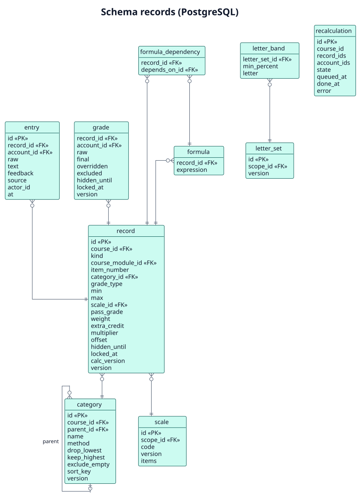

# Data model: academic records

PostgreSQL schema `records`, owned by `kampus-records`, following DEC-014, DEC-021, DEC-022, DEC-023 and DEC-026. Rules refer to the [records domain model](../../00-domain-model/records.md). Names are logical; physically the schema carries the installation prefix, `kmp_records` by default (DEC-039).

## Tables

| Table | Columns | Constraints and indexes |
| --- | --- | --- |
| `category` | `id`, `course_id` FK → `courses.course` (`CASCADE`), `parent_id` FK → `category` (`CASCADE`), `name`, `method`, `drop_lowest` smallint, `keep_highest` smallint, `exclude_empty`, `sort_key`, `version` | `CHECK` method in the eight methods; `CHECK` drop and keep not both set; one root per course (partial `UNIQUE` (`course_id`) where `parent_id` is null) |
| `record` | `id`, `course_id` FK (`CASCADE`), `kind` (`activity`, `manual`, `category_total`, `course_total`), `course_module_id` FK → `activities.course_module` (`CASCADE`, nullable), `item_number` smallint, `category_id` FK → `category` (`CASCADE`, nullable), `grade_type` (`value`, `scale`, `text`), `min` numeric(12,5), `max` numeric(12,5), `scale_id` FK → `scale` (`RESTRICT`), `pass_grade` numeric(12,5), `weight` numeric(9,5), `extra_credit` boolean, `multiplier` numeric(9,5), `offset` numeric(12,5), `hidden_until`, `locked_at`, `calc_version`, `version` | `UNIQUE` (`course_module_id`, `item_number`); `UNIQUE` (`category_id`) where kind is `category_total`; `UNIQUE` (`course_id`) where kind is `course_total`; `CHECK` `max` > `min`; `CHECK` scale set if and only if type is `scale` |
| `entry` | `id`, `record_id` FK (`CASCADE`), `account_id` FK → `identity.account`, `raw` numeric(12,5), `text`, `feedback`, `source` (`activity`, `teacher`, `import`, `formula`), `actor_id`, `at` | Append-only; index (`record_id`, `account_id`, `at`) |
| `grade` | `record_id` FK (`CASCADE`), `account_id` FK, `raw`, `final` numeric(12,5), `overridden`, `excluded`, `hidden_until`, `locked_at`, `version` | PK (`record_id`, `account_id`) — the upsert target (RN-096) |
| `scale` | `id`, `scope_id` FK → `access.scope`, `code`, `version`, `items` text[] | `UNIQUE` (`scope_id`, `code`, `version`) |
| `letter_set` | `id`, `scope_id` FK, `version` | `UNIQUE` (`scope_id`, `version`) |
| `letter_band` | `letter_set_id` FK (`CASCADE`), `min_percent` numeric(9,5), `letter` | PK (`letter_set_id`, `min_percent`) |
| `formula` | `record_id` PK FK (`CASCADE`), `expression` | Parsed and validated on save |
| `formula_dependency` | `record_id` FK → `formula` (`CASCADE`), `depends_on_id` FK → `record` (`RESTRICT`) | PK (`record_id`, `depends_on_id`); cycles refused on save (RN-107) |
| `recalculation` | `id`, `course_id`, `record_ids` (rows in `recalculation_record`), `account_ids` (rows in `recalculation_account`), `state`, `queued_at`, `done_at`, `error` | Queue of derived work (RN-099) |

## Anti-patterns avoided (DEC-014)

| Avoided | How |
| --- | --- |
| Totals cached and recomputed by the first reader | Derived by a job; reads have no side effects |
| One coefficient column whose meaning changes with the parent's method | Typed `weight` and `extra_credit` columns validated per method |
| History written only for some changes; dates reused with other meanings | Append-only entries with source, actor and time |
| Scale items as a comma list | Versioned scales with an array of items |
| Uniqueness of activity records checked in code | Unique constraints per course module and item |
