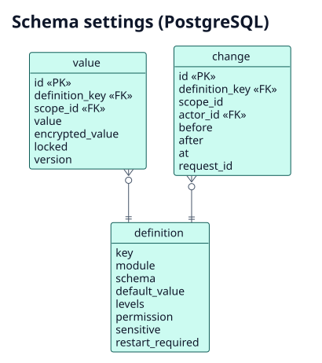

# Data model: settings

PostgreSQL schema `settings`, owned by `kampus-settings`, following DEC-014, DEC-021, DEC-022 and DEC-026. Rules refer to the [settings domain model](../../00-domain-model/settings.md). Names are logical; physically the schema carries the installation prefix, `kmp_settings` by default (DEC-039).

## Tables

| Table | Columns | Constraints and indexes |
| --- | --- | --- |
| `definition` | `key` PK, `module`, `schema` jsonb, `default_value` jsonb, `levels` text[], `permission`, `sensitive` boolean, `restart_required` boolean | Synchronised from declarations (DEC-015, RN-162) |
| `value` | `id`, `definition_key` FK → `definition` (`CASCADE`), `scope_id` FK → `access.scope` (`CASCADE`), `value` jsonb, `encrypted_value` bytea, `locked` boolean, `version` | `UNIQUE` (`definition_key`, `scope_id`); `CHECK` exactly one of `value` and `encrypted_value` (RN-167) |
| `change` | `id`, `definition_key` FK → `definition`, `scope_id`, `actor_id` FK → `identity.account`, `before` jsonb, `after` jsonb, `at`, `request_id` | Append-only; sensitive values stored masked; index (`definition_key`, `at`) |

Values fixed by the deployment are not stored: they are read from the configuration at start-up and returned with their source (RN-166).

## Anti-patterns avoided (DEC-014)

| Avoided | How |
| --- | --- |
| Untyped name and value text rows, validated by each screen | A declared schema checked on every write |
| Settings of plugins in one global table keyed by a concatenated name | Definitions per module, foreign keys from values |
| Secrets readable by anyone who can open the settings page | Encrypted, never returned |
| No record of who changed a setting | An append-only change table |
