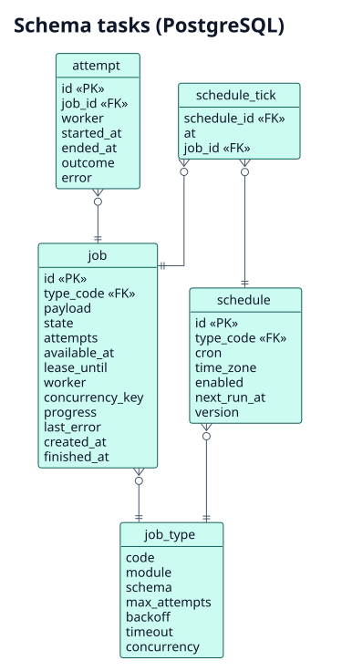

# Data model: tasks

PostgreSQL schema `tasks`, owned by `kampus-tasks`, following DEC-014, DEC-021, DEC-022 and DEC-026. Rules refer to the [tasks domain model](../../00-domain-model/tasks.md). Names are logical; physically the schema carries the installation prefix, `kmp_tasks` by default (DEC-039).

## Tables

| Table | Columns | Constraints and indexes |
| --- | --- | --- |
| `job_type` | `code` PK, `module`, `summary`, `max_attempts`, `backoff_seconds`, `timeout_seconds`, `concurrency` (a payload field), `retired_at` | Synchronised from declarations; a type no module declares is retired, never deleted. A payload schema per type arrives with the event schemas (DEC-055) |
| `job` | `id`, `type_code` FK → `job_type` (`RESTRICT`), `payload` jsonb, `state` (`queued`, `running`, `succeeded`, `failed`, `cancelled`), `attempts`, `available_at`, `lease_until`, `worker`, `concurrency_key`, `progress` (percent), `cancel_requested`, `last_error`, `created_at`, `finished_at` | Partial index (`available_at`) where `state = 'queued'`; partial `UNIQUE` (`concurrency_key`) where `state = 'running'` (RN-173); `available_at` defaults to the database clock; the lease lasts the type's timeout |
| `schedule` | `id`, `type_code` FK → `job_type` (`CASCADE`), `cron`, `time_zone`, `enabled`, `next_run_at`, `last_run_at`, `changed_by`, `version` | `UNIQUE` (`type_code`) for declared schedules |
| `schedule_tick` | `schedule_id` FK (`CASCADE`), `at`, `job_id` FK → `job` (`SET NULL`) | PK (`schedule_id`, `at`); inserted with `ON CONFLICT DO NOTHING` (RN-174) |
| `attempt` | `id`, `job_id` FK (`CASCADE`), `worker`, `started_at`, `ended_at`, `outcome` (`succeeded`, `failed`, `timed_out`, `lost`, `cancelled`), `error` | Index (`job_id`); purged with its job after 30 days by `tasks.purge` (RN-177) |

## Anti-patterns avoided (DEC-014)

| Avoided | How |
| --- | --- |
| Scheduled tasks guarded by a lock that a dead process never releases | Leases that expire |
| Ad hoc tasks serialised as class name plus data | A declared type and a validated payload |
| The same scheduled run started by two nodes | A unique tick per schedule and instant |
| "Now" taken from the process clock | The database clock for `available_at` |
