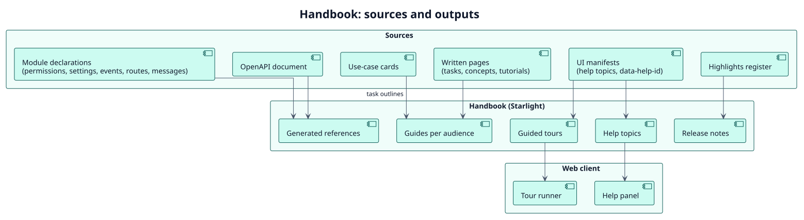

# Handbook

The product documentation of Kampus (DEC-011, DEC-077, DEC-078): a static site in `handbook/` built with Starlight, versioned per release, translatable and accessible, with **one guide per audience**, **generated references** and **help topics** opened from every screen. `docs/` stays the engineering specification. Requirement RF-009; RNF-020.

## Audiences and guides

| Guide | Audience | Covers |
| --- | --- | --- |
| Learner | Learners, guests | courses, activities, grades, progress, messages, calendar, profile, privacy requests |
| Teacher | Teachers, non-editing teachers | building courses and sections, activities, exceptions, grading, groups, communication, reports, rules |
| Section leader | Section leaders | what can be managed in a section (DEC-007) |
| Manager | Course creators, managers | categories, courses, users, enrolment, system groups, roles, terminology, custom fields |
| Mentor | Mentors | following assigned learners |
| Administrator | Campus and tenant administrators | settings, customisation, authentication, plugins, security, privacy, languages, tasks |
| Operator | Operators | installation, ports and backends (DEC-009), upgrades, backup, monitoring, scaling |
| Integrator | Integrators | API clients, OAuth, webhooks, LTI |
| Plugin developer | Plugin developers | the plugin SDK, UI modules, testing and packaging, the migration tool |
| Contributor | Core contributors | architecture, module contract, quality gates |
| Migration | Campuses moving to Kampus | the importer and what changes for each role |

## Page types

| Type | Purpose | Rule |
| --- | --- | --- |
| Task | How to do one thing (one use case, for one role) | Starts from the goal, numbered steps that match the screen, the result, what can go wrong; generated outline from the use case's main and alternative flows |
| Concept | What something is and why (scopes, grants, aggregation) | Links to the tasks that use it |
| Reference | Generated lists: permissions, settings, events, API, CLI, configuration, error codes, terms | Never written by hand (DEC-078) |
| Tutorial | A guided path for a new role (first course, first plugin) | Tested end to end in CI |
| Release notes | What changed, from the highlights register | One page per release |

## Help topics

| ID | Rule |
| --- | --- |
| HB-01 | Every route and contribution of a UI module declares a help topic id (UI-04); each topic id is a handbook page or a section of one, in the viewer's language and version. |
| HB-02 | The help panel shows the topic for the viewer's role, with the campus's terms applied (RN-212) and links to the full guide. |
| HB-03 | A missing topic fails the documentation check of the release; a topic whose screen changed is flagged for review by the use case's traceability. |
| HB-04 | Campuses can add their own pages to a topic (local procedures) as customisations, kept apart from the shipped text. |

## Onboarding and guided tours

| ID | Rule |
| --- | --- |
| HB-05 | Each role has an onboarding checklist shown on first sign-in (for example a teacher: create a section, add an activity, grade a submission); progress is kept with the person's preferences (`kampus-users`) and items tick themselves from the events of the real actions. |
| HB-06 | A guided tour is data: a list of steps, each pointing to a stable element id of a UI module (`data-help-id`), with a message key; a tour whose element is missing skips that step and reports it. |
| HB-07 | Tours are keyboard and screen-reader accessible, can be dismissed and restarted from the help panel, and never block the page. |

## Style guide

Plain language, second person, present tense; one task per page; screenshots generated by the end-to-end tests with the default theme; examples use neutral sample data; every page has a review date and an owner module.

## Checks in CI

Links and anchors, help topic coverage against the UI manifests, generated references in sync with the declarations, screenshots up to date, spelling per language, accessibility of the site.
