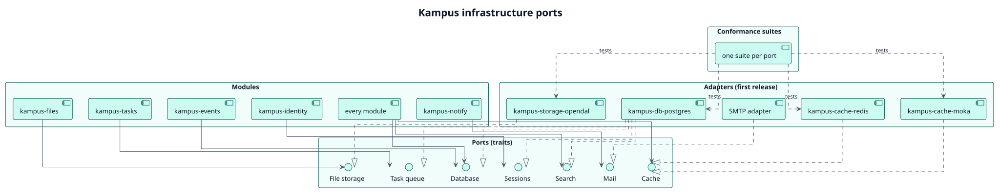

# Infrastructure ports

Every piece of infrastructure is a **port** (a Rust trait in a foundation crate) with interchangeable **adapters** chosen by the deployment configuration at start-up (DEC-009). Modules depend only on ports (RNF-019); an adapter is supported only when it passes the port's **conformance suite** in CI (DEC-066). This page fixes the contract of each port; the database port is detailed in DEC-065.

## Common rules

| ID | Rule |
| --- | --- |
| PR-01 | A port declares its operations, its guarantees (atomicity, ordering, consistency, durability) and its **capabilities** (optional features such as JSON indexes or presigned uploads). Callers ask for a capability; they never test for an adapter. |
| PR-02 | Each port has one conformance suite, written against the trait. Every adapter runs it in CI; an adapter that fails a test is not released. |
| PR-03 | Adapters are sub-plugins of their port: each lives in `crates/<port>/adapters/<name>`, is named `<port>-<name>` (`kampus-cache-redis`) and registers itself by the URL schemes it serves (DEC-086). `kampus-server` depends on every adapter through a registry that `tools/repo-check --fix` writes; adapters published outside the repository are declared in `crates/server/adapters.toml`. The repository check fails when a module depends on an adapter or the registry is stale. |
| PR-04 | Adapters are chosen by URL scheme in the deployment configuration and validated at start-up for the role being started (DEC-020); a missing capability that a module requires stops the start with a clear error. |
| PR-05 | Every adapter reports health, latency and error metrics with the same names (DEC-019), so dashboards do not depend on the backend. |
| PR-06 | Plugins (DEC-003) may add adapters; they pass the same suite and are loaded only when the operator configures them. |

## Database (`kampus-db`)

| Aspect | Contract |
| --- | --- |
| Schema | Written once per module in the **neutral schema format** of `kampus_db::schema` (`Table`, `Column`, `Type`, `ForeignKey`, `Check`, `Index`, and the changes of each step) (tables, columns with portable types, keys, foreign keys, checks, indexes) and turned into migrations per dialect. Physical names get the installation prefix (DEC-039). |
| Portable types | `uuid`, `text`, `varchar(n)`, `integer`, `bigint`, `numeric(p,s)`, `boolean`, `date`, `timestamptz`, `interval`, `bytea`, `json`, `text[]`; each dialect maps them (for example `text[]` to a JSON array where arrays do not exist). No other type is allowed in a module schema. |
| Queries | A typed, dialect-neutral query builder; raw SQL only inside a dialect adapter, with a written reason, and covered by the conformance suite. |
| Transactions | One transaction per service operation, with the outbox in it (DEC-016); isolation `READ COMMITTED` plus explicit row locks; `SKIP LOCKED`, upsert and advisory locks are capabilities with fallbacks. |
| Migrations | Forward-only, versioned per module, applied by the server or a dedicated command; each migration is tested from the previous release on every dialect. |
| First adapter | PostgreSQL. Next: MySQL and MariaDB, SQLite (development and small installations), then SQL Server and Oracle. |

## File storage (`kampus-storage`)

| Aspect | Contract |
| --- | --- |
| Operations | `put` (streamed, with expected hash), `get` (streamed, ranges), `head`, `delete`, `presign_get`, `presign_put` (capability), `copy` |
| Guarantees | A `put` is visible only once complete; keys are content hashes chosen by `kampus-files` (DEC-053), so overwrites never happen |
| First adapters | Local disk and S3-compatible, both through Apache OpenDAL (`kampus-storage-opendal`). Next: Azure Blob, Google Cloud Storage, WebDAV, SFTP, through the same adapter |
| Moving backends | A job copies, verifies the hash, switches and deletes (RN-136) |

## Cache (`kampus-cache`)

| Aspect | Contract |
| --- | --- |
| Definitions | Each module declares its caches: name, key type, value type, time to live, and the events that invalidate them |
| Levels | In-process (moka) in front of a shared cache (Redis or Valkey); without a shared cache only one instance may run, and the start checks it |
| Invalidation | By event through the bus on every node, never by hand in the code that writes; a value is always recomputable from the database |
| Extra operations | Counters with expiry (rate limits, RN-198) and short locks with a lease |
| First adapters | in-process (`kampus-cache-moka`) and Redis or Valkey (`kampus-cache-redis`), composed in two levels by `Layered`. Next: Memcached |

## Malware scanning (`kampus-scan`)

| Aspect | Contract |
| --- | --- |
| Operation | `scan(content)` answers clean or infected with the name of what was found; `check()` answers readiness |
| Use | Files scans every upload before keeping it, each time, since signatures change; infected content is refused and never stored (RN-129) |
| Without a scanner | Uploads are kept and marked `unscanned` |
| First adapter | ClamAV over TCP (`kampus-scan-clamd`, `clamd://host:port`, the `INSTREAM` command in chunks). Next: provider APIs |

## Sessions

Server-side sessions checked on every request (DEC-031). Operations: `create`, `touch`, `get`, `revoke`, `revoke_all(account)`. First adapter: the database; next: Redis or Valkey. Revocation of all sessions of an account is atomic.

## Task queue

The job model of [tasks](../../00-domain-model/tasks.md) (DEC-060): `enqueue` inside the caller's transaction, `claim` with a lease, `renew`, `complete`, `fail`. First adapter: the database (`FOR UPDATE SKIP LOCKED`); next: Redis or Valkey, NATS, which must keep enqueueing transactional through the outbox.

## Search

Operations: `index`, `remove`, `query` (text, filters, permissions filter, pagination). Documents are declared by modules with the fields to index; results are always filtered by what the requester may see before they are returned. First adapter: PostgreSQL full-text search; next: Meilisearch, OpenSearch or Elasticsearch. The index is rebuilt by a job and is never a source of truth.

## Mail

Operations: `send` (rendered message, headers, attachments by file id). Mail is always sent by a job (RN-149). First adapter: SMTP; next: provider APIs. Bounces and complaints are reported back as events when the adapter supports them (capability).

## Configuration

| Port | Variable | Schemes |
| --- | --- | --- |
| Database | `KAMPUS_DATABASE_URL` | `postgres://` (first), later `mysql://`, `sqlite://` |
| File storage | `KAMPUS_STORAGE_URL` | `file://`, `s3://` |
| Cache | `KAMPUS_CACHE_URL` | `redis://`, `valkey://`; empty for in-process only |
| Sessions | `KAMPUS_SESSIONS_URL` | empty for the database, `redis://` |
| Task queue | `KAMPUS_QUEUE_URL` | empty for the database |
| Search | `KAMPUS_SEARCH_URL` | empty for the database |
| Mail | `KAMPUS_MAIL_URL` | `smtp://`, provider schemes |

The full list is in [project configuration](../project-configuration.md#deployment-configuration).
