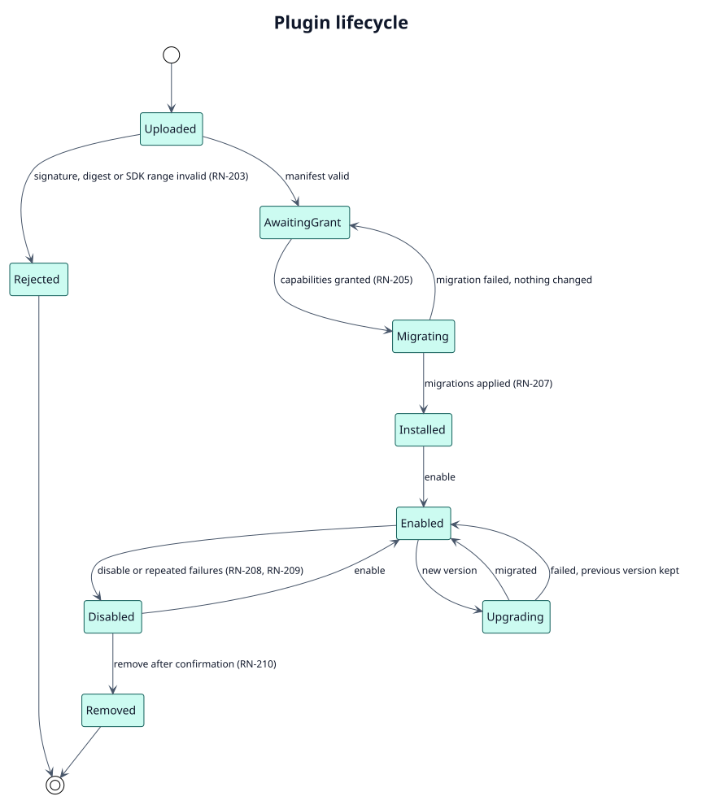

# Plugin SDK

The contract between Kampus and installable plugins (DEC-003, DEC-067 to DEC-069). A plugin is a **WebAssembly component** that exports the world of its plugin type and imports only host interfaces. The WIT packages are in [kampus.wit](./kampus.wit); the SDK crate (`kampus-sdk`) and the web SDK (`@kampus/sdk`) wrap them for Rust and for UI modules. Runtime rules are in the [plugins domain model](../../00-domain-model/plugins.md).

## Plugin types and their worlds

| Plugin type | World | Exports (what the plugin implements) | Extension points |
| --- | --- | --- | --- |
| Activity | `activity-plugin` | the activity contract of RN-075: settings schema, create, update, delete, copy, view model, grading, progress conditions, exceptions, backup | course modules, records, progress |
| Widget | `widget-plugin` | view model for a region, settings schema | layouts (RN-216) |
| Authentication | `auth-plugin` | sign-in step of the pipeline (DEC-030), profile mapping | sign-in pipeline |
| Enrolment | `enrol-plugin` | method settings, enrol, unenrol, sync job | enrolment methods (DEC-040) |
| Report | `report-plugin` | report definition, query through host data interfaces, export | reports |
| Question type | `question-plugin` | definition, render, response validation, grading | question bank |
| Course format | `format-plugin` | section presentation, navigation, layout defaults | course layouts (DEC-037) |
| Theme | `theme-plugin` | design tokens and assets, no code | themes (RN-217) |
| Local | `local-plugin` | listeners, jobs, routes, rule actions | anywhere through declared contributions |

Every world also exports `lifecycle` (install, upgrade, uninstall hooks) and may export `listener`, `job`, `route` and `rule-action`.

## Host interfaces (imports)

| Interface | Gives access to | Capability |
| --- | --- | --- |
| `kampus:host/context` | the request or job context: account, scope, language, time zone | always |
| `kampus:host/permissions` | `require` and `check` of declared permissions in a scope | always |
| `kampus:host/storage` | typed queries on the plugin's **own** tables | `own-data` |
| `kampus:host/data` | read models of core modules (courses, users, enrolments, records) filtered by the caller's permissions | `read:<module>` per module |
| `kampus:host/events` | publish the plugin's declared events | `events` |
| `kampus:host/jobs` | enqueue the plugin's declared jobs | `jobs` |
| `kampus:host/files` | files of the plugin's areas (DEC-053) | `files` |
| `kampus:host/strings` | the plugin's messages and terms, resolved (DEC-062, RN-212) | always |
| `kampus:host/settings` | the plugin's settings, resolved by scope | always |
| `kampus:host/http` | outbound HTTPS to hosts declared in the manifest | `http:<host>` |
| `kampus:host/log` | structured logs and metrics with the plugin's id | always |

No interface gives raw SQL, the file system, environment variables, clocks other than the context's, or network access outside `http`.

## Manifest

A `kampus-plugin.toml` inside the package declares:

| Section | Content |
| --- | --- |
| `[plugin]` | id (reverse domain), type, name, version, publisher, SDK range, licence |
| `[capabilities]` | the capabilities of the table above, each with a reason shown to administrators |
| `[contributions]` | permissions, settings, events, jobs, schedules, routes, UI modules, help topics, messages, terms, rule triggers and actions, feature flags (the `Module` contract of DEC-015) |
| `[schema]` | the neutral schema of its tables (DEC-065) and its migrations |
| `[privacy]` | data categories and the export and erase handlers (RN-178) |

## Lifecycle

| Step | What the host does |
| --- | --- |
| Install | verifies signature, digest and SDK range (RN-203); validates the manifest; shows the capabilities (RN-205) |
| Grant | records the administrator's grants; nothing runs before |
| Migrate | applies the plugin's migrations, one transaction per step (RN-207) |
| Enable | registers contributions; the plugin's routes, listeners, jobs and UI modules become live |
| Upgrade | as install, then migrations; new capabilities wait for a grant while the old version runs |
| Disable | stops everything at once, keeps data (RN-209) |
| Remove | privacy handler, then tables and files after confirmation (RN-210) |

## Compatibility and tooling

- The SDK follows semantic versioning; host interfaces change additively within a major version (RN-211). Deprecated functions keep working until the next major.
- `kampus plugin new <type>` scaffolds a plugin; `kampus plugin test` runs it against a host test harness with an in-memory database; `kampus plugin pack` builds, signs and packages it.
- The migration tool (`moodle2kampus`, DEC-006) targets these worlds.
