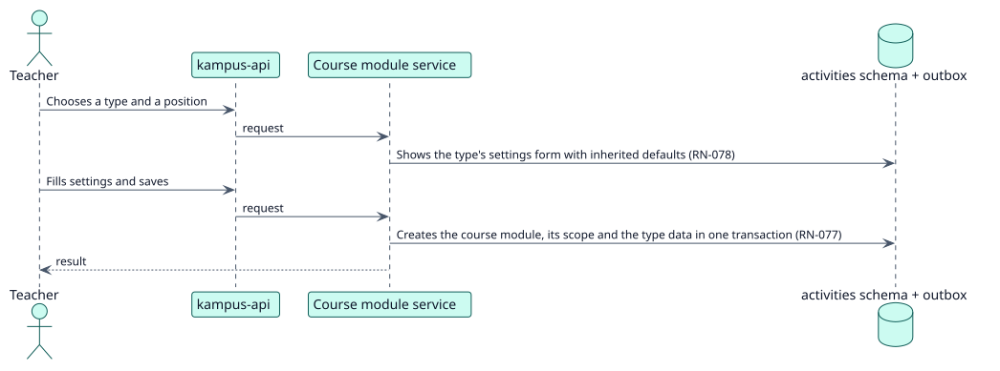

# UC-021 Add an activity or material — design realization

| Overview | Requirements | Analysis | Design | Implementation | Tests |
| --- | --- | --- | --- | --- | --- |
| [Use cases](../../../01-requirements/use-case-overview.svg) | [Requirements](../../../01-requirements/use-cases/addActivity/README.md) | [Analysis](../../../02-analysis/use-cases/addActivity/README.md) | **Design** | [Implementation](../../../04-implementation/use-cases/addActivity/README.md) | [Tests](../../../04-implementation/use-cases/addActivity/README.md#tests) |

Analysis: [README](../../../02-analysis/use-cases/addActivity/README.md)

## Elements

| Design element | Kind | Code target |
| --- | --- | --- |
| Course module service | service | `crates/kampus-activities/src/module.rs` |
| `POST /api/v1/sections/{section_id}/course-modules` | API endpoint | `docs/03-design/api/activities.openapi.yaml` |

## Sequence

## Data touched

| Table or entity | Operation |
| --- | --- |
| activities.course_module, activities.module_setting, the type schema | insert |
| records.record, progress.rule | insert (through their services) |
