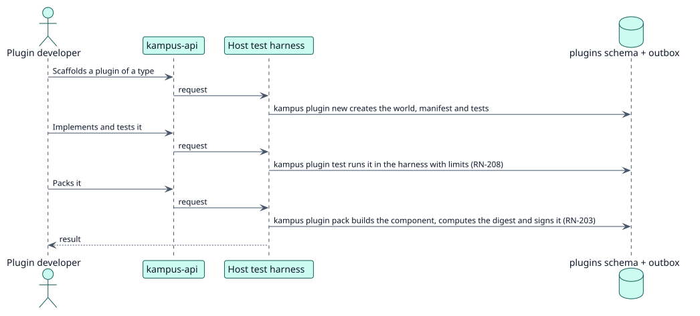

# UC-051 Build and package a plugin — design realization

| Overview | Requirements | Analysis | Design | Implementation | Tests |
| --- | --- | --- | --- | --- | --- |
| [Use cases](../../../01-requirements/use-case-overview.svg) | [Requirements](../../../01-requirements/use-cases/buildPlugin/README.md) | [Analysis](../../../02-analysis/use-cases/buildPlugin/README.md) | **Design** | [Implementation](../../../04-implementation/use-cases/buildPlugin/README.md) | [Tests](../../../04-implementation/use-cases/buildPlugin/README.md#tests) |

Analysis: [README](../../../02-analysis/use-cases/buildPlugin/README.md)

## Elements

| Design element | Kind | Code target |
| --- | --- | --- |
| SDK and test harness | tool | `crates/kampus-sdk`, `crates/kampus-plugin-host/src/harness.rs` |
| WIT packages | contract | `docs/03-design/sdk/kampus.wit` |

## Sequence

## Data touched

| Table or entity | Operation |
| --- | --- |
| none (local build) | — |
