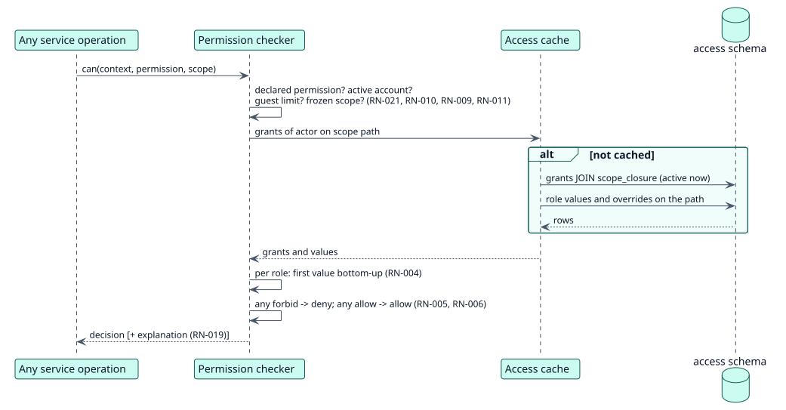

# UC-003 Check a permission, with its explanation — design realization

| Overview | Requirements | Analysis | Design | Implementation | Tests |
| --- | --- | --- | --- | --- | --- |
| [Use cases](../../../01-requirements/use-case-overview.svg) | [Requirements](../../../01-requirements/use-cases/checkPermission/README.md) | [Analysis](../../../02-analysis/use-cases/checkPermission/README.md) | **Design** | [Implementation](../../../04-implementation/use-cases/checkPermission/README.md) | [Tests](../../../04-implementation/use-cases/checkPermission/README.md#tests) |

Analysis: [README](../../../02-analysis/use-cases/checkPermission/README.md)

## Elements

| Design element | Kind | Code target |
| --- | --- | --- |
| Permission checker | service | `crates/kampus-access/src/check.rs` |
| Per-user access cache | cache | `crates/kampus-access/src/cache.rs` |
| `POST /api/v1/scopes/{scope_id}/checks` | API endpoint | `docs/03-design/api/access.openapi.yaml` |

## Sequence

## Data touched

| Table or entity | Operation |
| --- | --- |
| access.grant, access.role_permission, access.permission_override, access.scope_closure | read (cached) |
