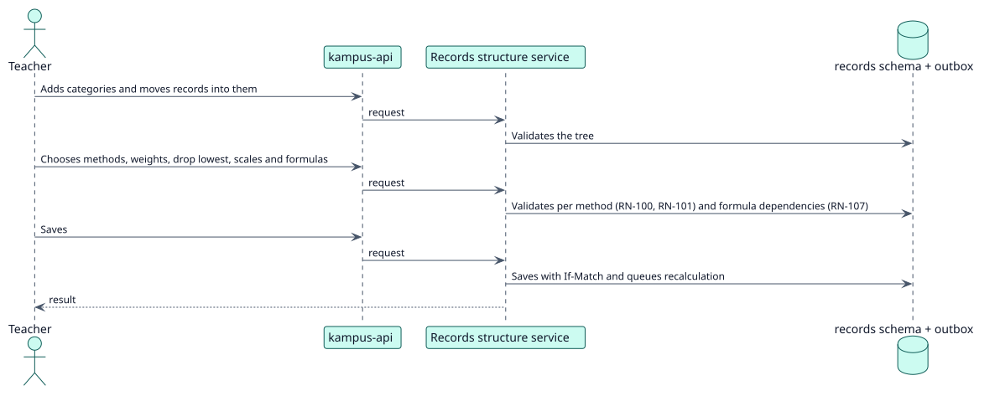

# UC-027 Configure the academic records of a course — design realization

| Overview | Requirements | Analysis | Design | Implementation | Tests |
| --- | --- | --- | --- | --- | --- |
| [Use cases](../../../01-requirements/use-case-overview.svg) | [Requirements](../../../01-requirements/use-cases/configureRecords/README.md) | [Analysis](../../../02-analysis/use-cases/configureRecords/README.md) | **Design** | [Implementation](../../../04-implementation/use-cases/configureRecords/README.md) | [Tests](../../../04-implementation/use-cases/configureRecords/README.md#tests) |

Analysis: [README](../../../02-analysis/use-cases/configureRecords/README.md)

## Elements

| Design element | Kind | Code target |
| --- | --- | --- |
| Records structure service | service | `crates/records/src/structure.rs` |
| Aggregation methods | service | `crates/records/src/aggregation.rs` |
| `/api/v1/records/courses/{course_id}/records/*`, `/api/v1/records/records/{record_id}` | API endpoints | `docs/03-design/api/records.openapi.yaml` |

## Sequence

## Data touched

| Table or entity | Operation |
| --- | --- |
| records.category, records.record, records.formula, records.formula_dependency, records.scale | insert, update |
