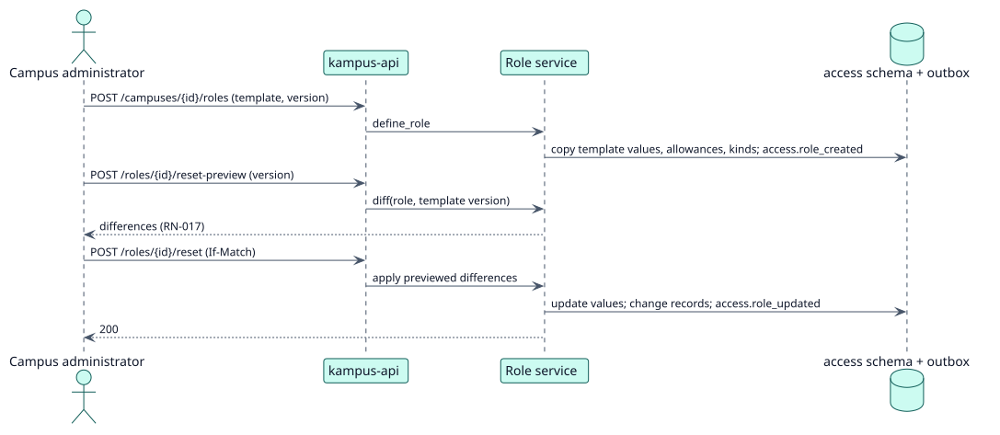

# UC-004 Define a role from a template — design realization

| Overview | Requirements | Analysis | Design | Implementation | Tests |
| --- | --- | --- | --- | --- | --- |
| [Use cases](../../../01-requirements/use-case-overview.svg) | [Requirements](../../../01-requirements/use-cases/defineRole/README.md) | [Analysis](../../../02-analysis/use-cases/defineRole/README.md) | **Design** | [Implementation](../../../04-implementation/use-cases/defineRole/README.md) | [Tests](../../../04-implementation/use-cases/defineRole/README.md#tests) |

Analysis: [README](../../../02-analysis/use-cases/defineRole/README.md)

## Elements

| Design element | Kind | Code target |
| --- | --- | --- |
| Role service | service | `crates/access/src/service/role.rs` |
| `/api/v1/access/campuses/{campus_id}/roles`, `/api/v1/access/roles/{role_id}`, reset preview and reset | API endpoints | `docs/03-design/api/access.openapi.yaml` |
| `access.role`, `access.role_permission`, `access.role_allowance` | tables | `docs/03-design/data-model/access.md` |

## Sequence

## Data touched

| Table or entity | Operation |
| --- | --- |
| access.role, access.role_permission, access.role_allowance, access.role_scope_kind | insert, update, delete |
| access.change | insert |
