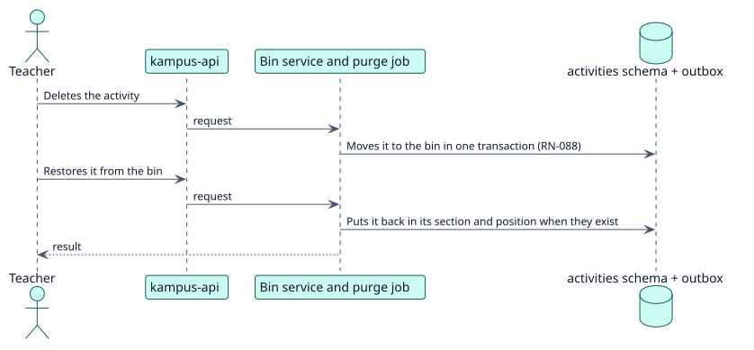

# UC-025 Delete and restore an activity — design realization

| Overview | Requirements | Analysis | Design | Implementation | Tests |
| --- | --- | --- | --- | --- | --- |
| [Use cases](../../../01-requirements/use-case-overview.svg) | [Requirements](../../../01-requirements/use-cases/deleteActivity/README.md) | [Analysis](../../../02-analysis/use-cases/deleteActivity/README.md) | **Design** | [Implementation](../../../04-implementation/use-cases/deleteActivity/README.md) | [Tests](../../../04-implementation/use-cases/deleteActivity/README.md#tests) |

Analysis: [README](../../../02-analysis/use-cases/deleteActivity/README.md)

## Elements

| Design element | Kind | Code target |
| --- | --- | --- |
| Bin service and purge job | service | `crates/activities/src/bin.rs` |
| `/api/v1/activities/courses/{course_id}/bin`, restore, retry | API endpoints | `docs/03-design/api/activities.openapi.yaml` |

## Sequence

## Data touched

| Table or entity | Operation |
| --- | --- |
| activities.course_module, activities.bin_item | update, insert |
| owned data of every module | delete by cascade on purge |
