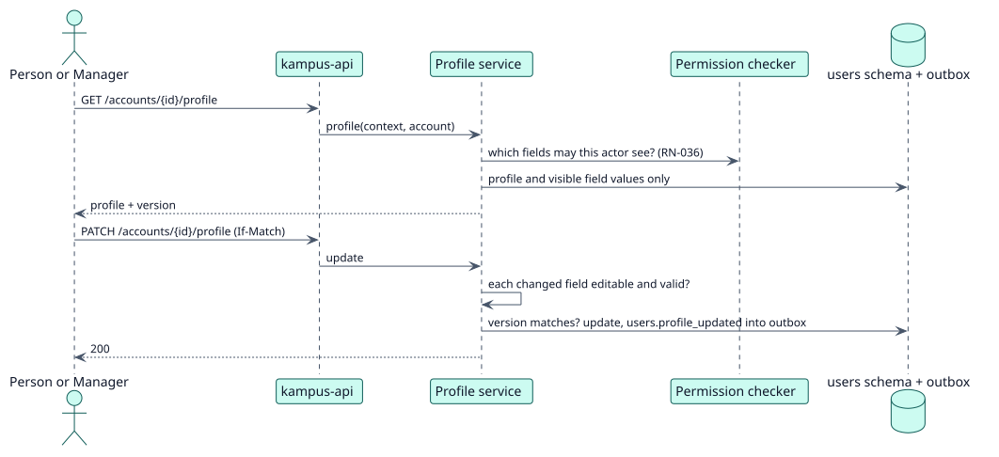

# UC-010 Edit a profile — design realization

| Overview | Requirements | Analysis | Design | Implementation | Tests |
| --- | --- | --- | --- | --- | --- |
| [Use cases](../../../01-requirements/use-case-overview.svg) | [Requirements](../../../01-requirements/use-cases/editProfile/README.md) | [Analysis](../../../02-analysis/use-cases/editProfile/README.md) | **Design** | [Implementation](../../../04-implementation/use-cases/editProfile/README.md) | [Tests](../../../04-implementation/use-cases/editProfile/README.md#tests) |

Analysis: [README](../../../02-analysis/use-cases/editProfile/README.md)

## Elements

| Design element | Kind | Code target |
| --- | --- | --- |
| Profile service | service | `crates/users/src/profile.rs` |
| `/api/v1/me/profile`, `/api/v1/accounts/{account_id}/profile` | API endpoints | `docs/03-design/api/identity.openapi.yaml` |
| `users.profile`, `users.account_field, customise.field_value` | tables | `docs/03-design/data-model/identity.md` |

## Sequence

## Data touched

| Table or entity | Operation |
| --- | --- |
| users.profile, users.account_field, customise.field_value | update |
