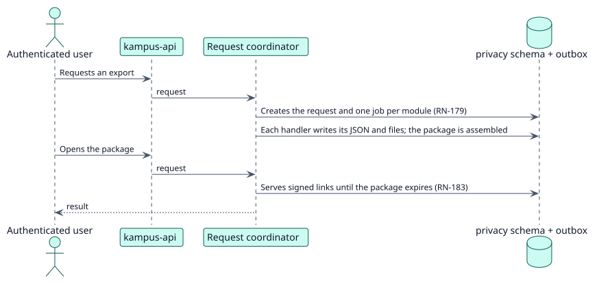

# UC-043 Export my personal data — design realization

| Overview | Requirements | Analysis | Design | Implementation | Tests |
| --- | --- | --- | --- | --- | --- |
| [Use cases](../../../01-requirements/use-case-overview.svg) | [Requirements](../../../01-requirements/use-cases/exportMyData/README.md) | [Analysis](../../../02-analysis/use-cases/exportMyData/README.md) | **Design** | [Implementation](../../../04-implementation/use-cases/exportMyData/README.md) | [Tests](../../../04-implementation/use-cases/exportMyData/README.md#tests) |

Analysis: [README](../../../02-analysis/use-cases/exportMyData/README.md)

## Elements

| Design element | Kind | Code target |
| --- | --- | --- |
| Request coordinator | service | `crates/privacy/src/requests.rs` |
| `/api/v1/privacy/privacy/requests` | API endpoints | `docs/03-design/api/privacy.openapi.yaml` |

## Sequence

## Data touched

| Table or entity | Operation |
| --- | --- |
| privacy.request, privacy.request_item, privacy.export_package | insert, update |
| tasks.job | insert (through its service) |
