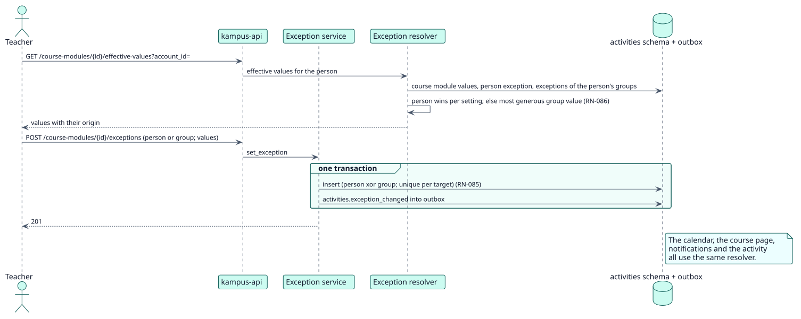

# UC-023 Grant an exception — design realization

| Overview | Requirements | Analysis | Design | Implementation | Tests |
| --- | --- | --- | --- | --- | --- |
| [Use cases](../../../01-requirements/use-case-overview.svg) | [Requirements](../../../01-requirements/use-cases/grantException/README.md) | [Analysis](../../../02-analysis/use-cases/grantException/README.md) | **Design** | [Implementation](../../../04-implementation/use-cases/grantException/README.md) | [Tests](../../../04-implementation/use-cases/grantException/README.md#tests) |

Analysis: [README](../../../02-analysis/use-cases/grantException/README.md)

## Elements

| Design element | Kind | Code target |
| --- | --- | --- |
| Exception resolver | service | `crates/kampus-activities/src/exceptions.rs` |
| `/api/v1/course-modules/{course_module_id}/exceptions`, effective values | API endpoints | `docs/03-design/api/activities.openapi.yaml` |

## Sequence

## Data touched

| Table or entity | Operation |
| --- | --- |
| activities.exception | insert, update, delete |
