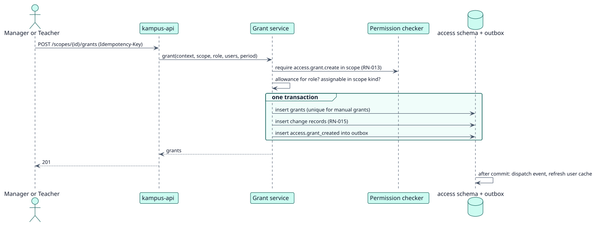

# UC-001 Grant a role in a scope — design realization

| Overview | Requirements | Analysis | Design | Implementation | Tests |
| --- | --- | --- | --- | --- | --- |
| [Use cases](../../../01-requirements/use-case-overview.svg) | [Requirements](../../../01-requirements/use-cases/grantRole/README.md) | [Analysis](../../../02-analysis/use-cases/grantRole/README.md) | **Design** | [Implementation](../../../04-implementation/use-cases/grantRole/README.md) | [Tests](../../../04-implementation/use-cases/grantRole/README.md#tests) |

Analysis: [README](../../../02-analysis/use-cases/grantRole/README.md)

## Elements

| Design element | Kind | Code target |
| --- | --- | --- |
| Grant service | service | `crates/kampus-access/src/grant.rs` |
| `POST /api/v1/scopes/{scope_id}/grants` | API endpoint | `docs/03-design/api/access.openapi.yaml` |
| `access.grant` | table | `docs/03-design/data-model/access.md` |

## Sequence

## Data touched

| Table or entity | Operation |
| --- | --- |
| access.grant | insert |
| access.change | insert |
| events outbox | insert `access.grant_created` |
