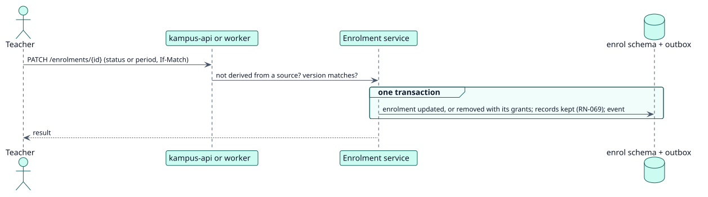

# UC-018 Manage an enrolment — design realization

| Overview | Requirements | Analysis | Design | Implementation | Tests |
| --- | --- | --- | --- | --- | --- |
| [Use cases](../../../01-requirements/use-case-overview.svg) | [Requirements](../../../01-requirements/use-cases/manageEnrolment/README.md) | [Analysis](../../../02-analysis/use-cases/manageEnrolment/README.md) | **Design** | [Implementation](../../../04-implementation/use-cases/manageEnrolment/README.md) | [Tests](../../../04-implementation/use-cases/manageEnrolment/README.md#tests) |

Analysis: [README](../../../02-analysis/use-cases/manageEnrolment/README.md)

## Elements

| Design element | Kind | Code target |
| --- | --- | --- |
| Enrolment service | service | `crates/enrol/src/enrolment.rs` |
| `/api/v1/enrol/enrolments/{enrolment_id}` | API endpoint | `docs/03-design/api/enrolment.openapi.yaml` |
| `enrol.enrolment` | table | `docs/03-design/data-model/enrolment.md` |

## Sequence

## Data touched

| Table or entity | Operation |
| --- | --- |
| enrol.enrolment | update, delete |
| access.grant | delete owned grants |
