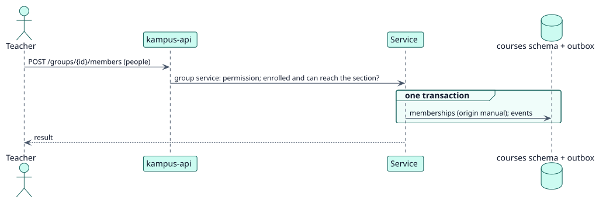

# UC-014 Manage groups and group sets — design realization

| Overview | Requirements | Analysis | Design | Implementation | Tests |
| --- | --- | --- | --- | --- | --- |
| [Use cases](../../../01-requirements/use-case-overview.svg) | [Requirements](../../../01-requirements/use-cases/manageGroups/README.md) | [Analysis](../../../02-analysis/use-cases/manageGroups/README.md) | **Design** | [Implementation](../../../04-implementation/use-cases/manageGroups/README.md) | [Tests](../../../04-implementation/use-cases/manageGroups/README.md#tests) |

Analysis: [README](../../../02-analysis/use-cases/manageGroups/README.md)

## Elements

| Design element | Kind | Code target |
| --- | --- | --- |
| Group service | service | `crates/kampus-courses/src/group.rs` |
| `/api/v1/courses/{course_id}/groups`, `/api/v1/groups/{group_id}/members`, group sets | API endpoints | `docs/03-design/api/courses.openapi.yaml` |
| `courses.group`, `courses.group_member`, `courses.group_set` | tables | `docs/03-design/data-model/courses.md` |

## Sequence

## Data touched

| Table or entity | Operation |
| --- | --- |
| courses.group, courses.group_member, courses.group_set, courses.group_set_group | insert, update, delete |
| settings | group mode per scope |
