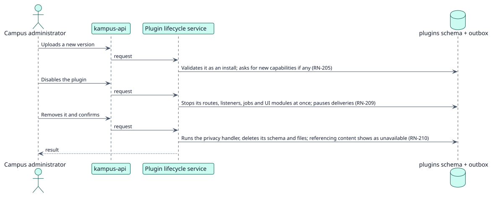

# UC-050 Upgrade, disable or remove a plugin — design realization

| Overview | Requirements | Analysis | Design | Implementation | Tests |
| --- | --- | --- | --- | --- | --- |
| [Use cases](../../../01-requirements/use-case-overview.svg) | [Requirements](../../../01-requirements/use-cases/managePlugin/README.md) | [Analysis](../../../02-analysis/use-cases/managePlugin/README.md) | **Design** | [Implementation](../../../04-implementation/use-cases/managePlugin/README.md) | [Tests](../../../04-implementation/use-cases/managePlugin/README.md#tests) |

Analysis: [README](../../../02-analysis/use-cases/managePlugin/README.md)

## Elements

| Design element | Kind | Code target |
| --- | --- | --- |
| Plugin lifecycle service | service | `crates/plugin-host/src/lifecycle.rs` |
| `/api/v1/plugins/{plugin_id}` | API endpoints | `docs/03-design/api/plugins.openapi.yaml` |

## Sequence

## Data touched

| Table or entity | Operation |
| --- | --- |
| plugins.installation, plugins.version, plugins.failure | update, insert |
| the plugin's own schema | migrate, drop |
