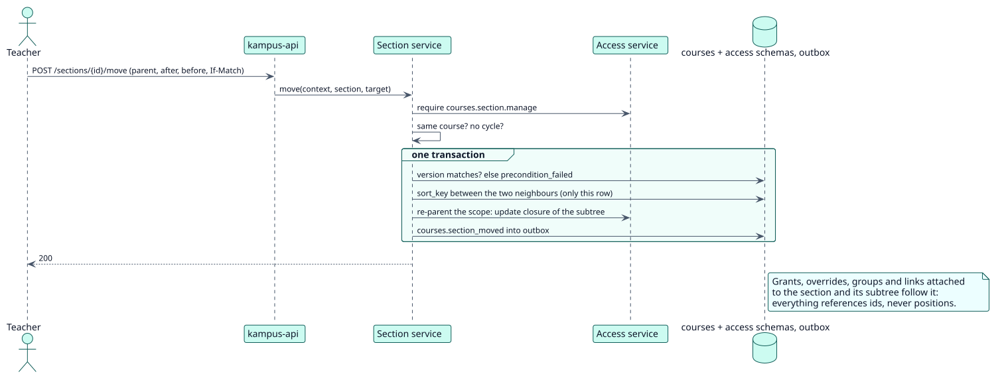

# UC-013 Organise the sections of a course — design realization

| Overview | Requirements | Analysis | Design | Implementation | Tests |
| --- | --- | --- | --- | --- | --- |
| [Use cases](../../../01-requirements/use-case-overview.svg) | [Requirements](../../../01-requirements/use-cases/organiseSections/README.md) | [Analysis](../../../02-analysis/use-cases/organiseSections/README.md) | **Design** | [Implementation](../../../04-implementation/use-cases/organiseSections/README.md) | [Tests](../../../04-implementation/use-cases/organiseSections/README.md#tests) |

Analysis: [README](../../../02-analysis/use-cases/organiseSections/README.md)

## Elements

| Design element | Kind | Code target |
| --- | --- | --- |
| Section service | service | `crates/kampus-courses/src/section.rs` |
| `/api/v1/courses/{course_id}/sections`, `/api/v1/sections/{section_id}`, move | API endpoints | `docs/03-design/api/courses.openapi.yaml` |
| `courses.section` | table | `docs/03-design/data-model/courses.md` |

## Sequence

## Data touched

| Table or entity | Operation |
| --- | --- |
| courses.section | insert, update, soft delete then purge |
| access.scope_closure | update on move |
