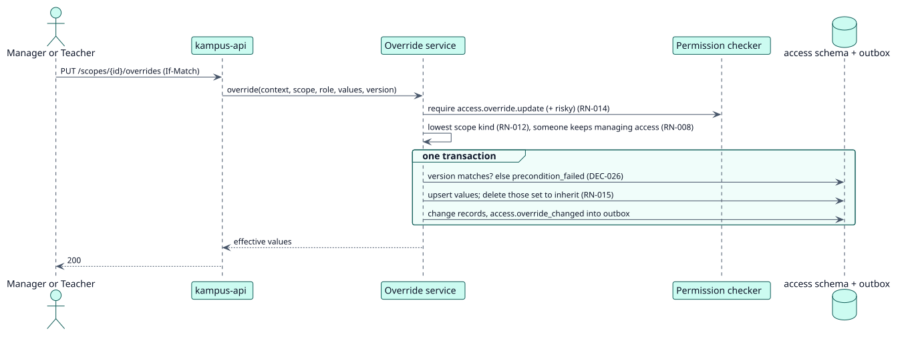

# UC-002 Override permissions in a scope — design realization

| Overview | Requirements | Analysis | Design | Implementation | Tests |
| --- | --- | --- | --- | --- | --- |
| [Use cases](../../../01-requirements/use-case-overview.svg) | [Requirements](../../../01-requirements/use-cases/overridePermission/README.md) | [Analysis](../../../02-analysis/use-cases/overridePermission/README.md) | **Design** | [Implementation](../../../04-implementation/use-cases/overridePermission/README.md) | [Tests](../../../04-implementation/use-cases/overridePermission/README.md#tests) |

Analysis: [README](../../../02-analysis/use-cases/overridePermission/README.md)

## Elements

| Design element | Kind | Code target |
| --- | --- | --- |
| Override service | service | `crates/access/src/service/overrides.rs` |
| `PUT /api/v1/access/scopes/{scope_id}/overrides` | API endpoint | `docs/03-design/api/access.openapi.yaml` |
| `access.permission_override` | table | `docs/03-design/data-model/access.md` |

## Sequence

## Data touched

| Table or entity | Operation |
| --- | --- |
| access.permission_override | upsert or delete |
| access.change | insert |
| events outbox | insert `access.override_changed` |
