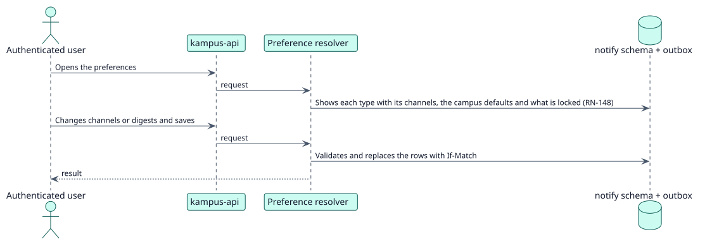

# UC-037 Choose how to be notified — design realization

| Overview | Requirements | Analysis | Design | Implementation | Tests |
| --- | --- | --- | --- | --- | --- |
| [Use cases](../../../01-requirements/use-case-overview.svg) | [Requirements](../../../01-requirements/use-cases/setNotificationPreferences/README.md) | [Analysis](../../../02-analysis/use-cases/setNotificationPreferences/README.md) | **Design** | [Implementation](../../../04-implementation/use-cases/setNotificationPreferences/README.md) | [Tests](../../../04-implementation/use-cases/setNotificationPreferences/README.md#tests) |

Analysis: [README](../../../02-analysis/use-cases/setNotificationPreferences/README.md)

## Elements

| Design element | Kind | Code target |
| --- | --- | --- |
| Preference resolver | service | `crates/kampus-notify/src/preferences.rs` |
| `/api/v1/notification-preferences` | API endpoint | `docs/03-design/api/notify.openapi.yaml` |

## Sequence

## Data touched

| Table or entity | Operation |
| --- | --- |
| notify.preference | replace |
| notify.campus_default | select |
