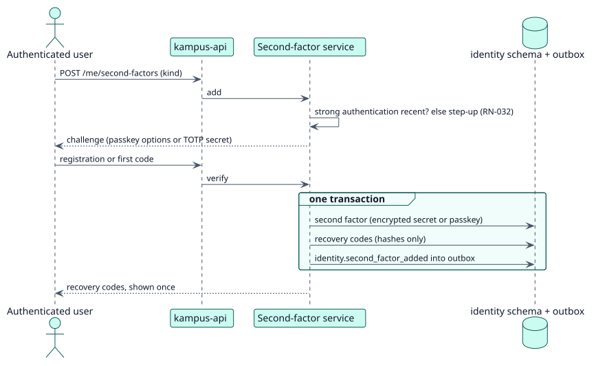

# UC-008 Set up a second factor — design realization

| Overview | Requirements | Analysis | Design | Implementation | Tests |
| --- | --- | --- | --- | --- | --- |
| [Use cases](../../../01-requirements/use-case-overview.svg) | [Requirements](../../../01-requirements/use-cases/setUpSecondFactor/README.md) | [Analysis](../../../02-analysis/use-cases/setUpSecondFactor/README.md) | **Design** | [Implementation](../../../04-implementation/use-cases/setUpSecondFactor/README.md) | [Tests](../../../04-implementation/use-cases/setUpSecondFactor/README.md#tests) |

Analysis: [README](../../../02-analysis/use-cases/setUpSecondFactor/README.md)

## Elements

| Design element | Kind | Code target |
| --- | --- | --- |
| Second-factor service | service | `crates/kampus-identity/src/second_factor.rs` |
| `/api/v1/me/second-factors` | API endpoints | `docs/03-design/api/identity.openapi.yaml` |
| `identity.second_factor`, `identity.passkey`, `identity.recovery_code` | tables | `docs/03-design/data-model/identity.md` |

## Sequence

## Data touched

| Table or entity | Operation |
| --- | --- |
| identity.second_factor, identity.passkey, identity.recovery_code | insert, delete |
