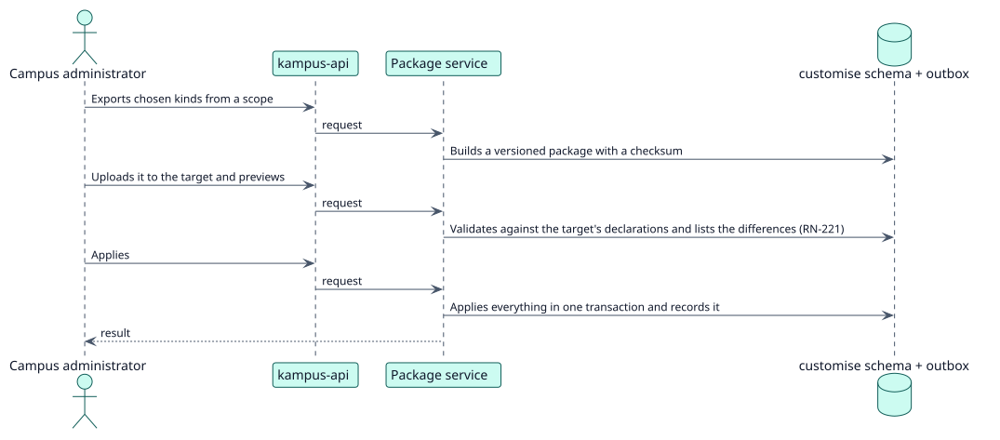

# UC-058 Export and import customisations — design realization

| Overview | Requirements | Analysis | Design | Implementation | Tests |
| --- | --- | --- | --- | --- | --- |
| [Use cases](../../../01-requirements/use-case-overview.svg) | [Requirements](../../../01-requirements/use-cases/shareCustomisation/README.md) | [Analysis](../../../02-analysis/use-cases/shareCustomisation/README.md) | **Design** | [Implementation](../../../04-implementation/use-cases/shareCustomisation/README.md) | [Tests](../../../04-implementation/use-cases/shareCustomisation/README.md#tests) |

Analysis: [README](../../../02-analysis/use-cases/shareCustomisation/README.md)

## Elements

| Design element | Kind | Code target |
| --- | --- | --- |
| Package service | service | `crates/kampus-customise/src/packages.rs` |
| `/api/v1/scopes/{scope_id}/customisation-packages`, `/customisation-imports` | API endpoints | `docs/03-design/api/customise.openapi.yaml` |

## Sequence

## Data touched

| Table or entity | Operation |
| --- | --- |
| every customise table | insert, update, delete |
| customise.change | insert |
