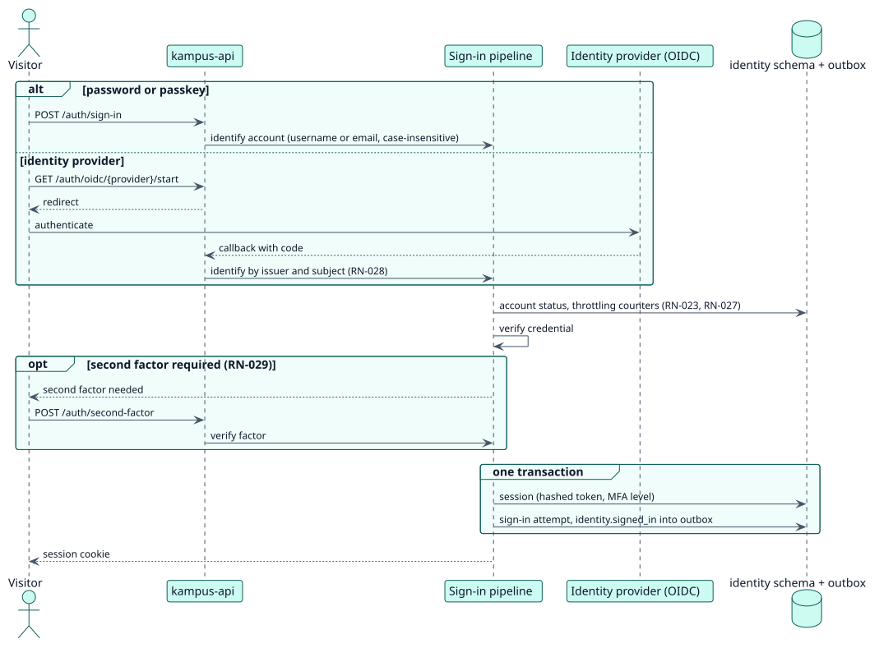

# UC-007 Sign in, or recover access — design realization

| Overview | Requirements | Analysis | Design | Implementation | Tests |
| --- | --- | --- | --- | --- | --- |
| [Use cases](../../../01-requirements/use-case-overview.svg) | [Requirements](../../../01-requirements/use-cases/signIn/README.md) | [Analysis](../../../02-analysis/use-cases/signIn/README.md) | **Design** | [Implementation](../../../04-implementation/use-cases/signIn/README.md) | [Tests](../../../04-implementation/use-cases/signIn/README.md#tests) |

Analysis: [README](../../../02-analysis/use-cases/signIn/README.md)

## Elements

| Design element | Kind | Code target |
| --- | --- | --- |
| Sign-in pipeline | service | `crates/identity/src/service/sign_in.rs` |
| OIDC client | adapter | `crates/identity/src/service/oidc.rs` |
| `/api/v1/identity/auth/sign-in`, `/second-factor`, `/oidc/*`, `/recovery` | API endpoints | `docs/03-design/api/identity.openapi.yaml` |
| `identity.session`, `identity.sign_in_attempt` | tables | `docs/03-design/data-model/identity.md` |

## Sequence

## Data touched

| Table or entity | Operation |
| --- | --- |
| identity.session | insert |
| identity.sign_in_attempt | insert |
| identity.external_identity | insert when linking |
