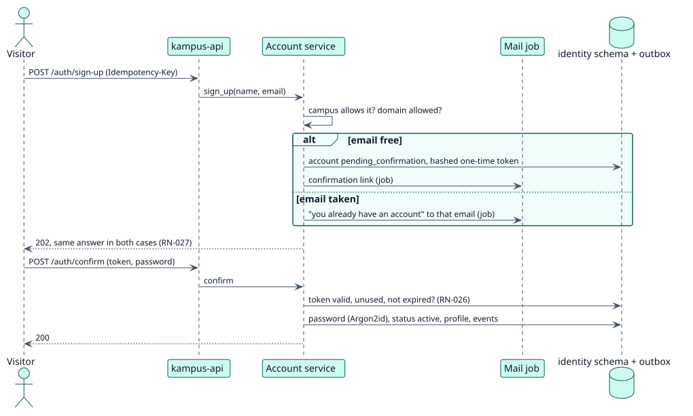

# UC-006 Sign up and confirm an account — design realization

| Overview | Requirements | Analysis | Design | Implementation | Tests |
| --- | --- | --- | --- | --- | --- |
| [Use cases](../../../01-requirements/use-case-overview.svg) | [Requirements](../../../01-requirements/use-cases/signUp/README.md) | [Analysis](../../../02-analysis/use-cases/signUp/README.md) | **Design** | [Implementation](../../../04-implementation/use-cases/signUp/README.md) | [Tests](../../../04-implementation/use-cases/signUp/README.md#tests) |

Analysis: [README](../../../02-analysis/use-cases/signUp/README.md)

## Elements

| Design element | Kind | Code target |
| --- | --- | --- |
| Account service | service | `crates/kampus-identity/src/account.rs` |
| `/api/v1/auth/sign-up`, `/api/v1/auth/confirm` | API endpoints | `docs/03-design/api/identity.openapi.yaml` |
| `identity.account`, `identity.one_time_token` | tables | `docs/03-design/data-model/identity.md` |

## Sequence

## Data touched

| Table or entity | Operation |
| --- | --- |
| identity.account | insert, update |
| identity.one_time_token | insert, update |
| identity.password | insert |
| users.profile | insert |
